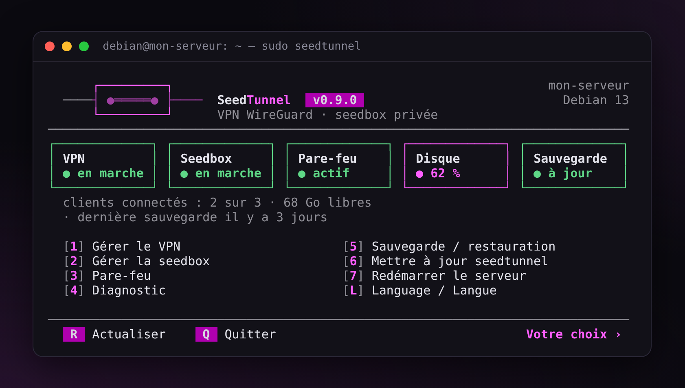
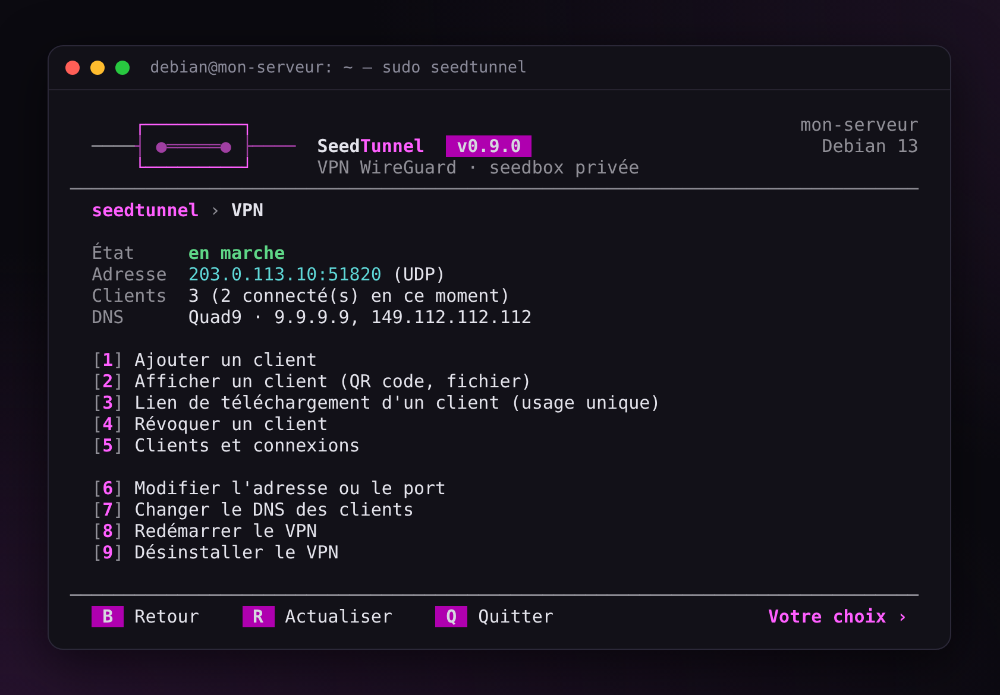
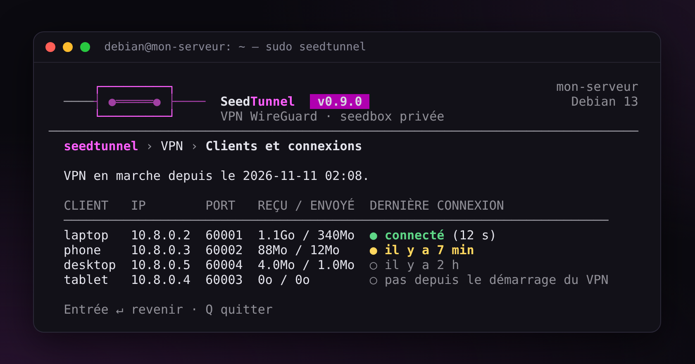
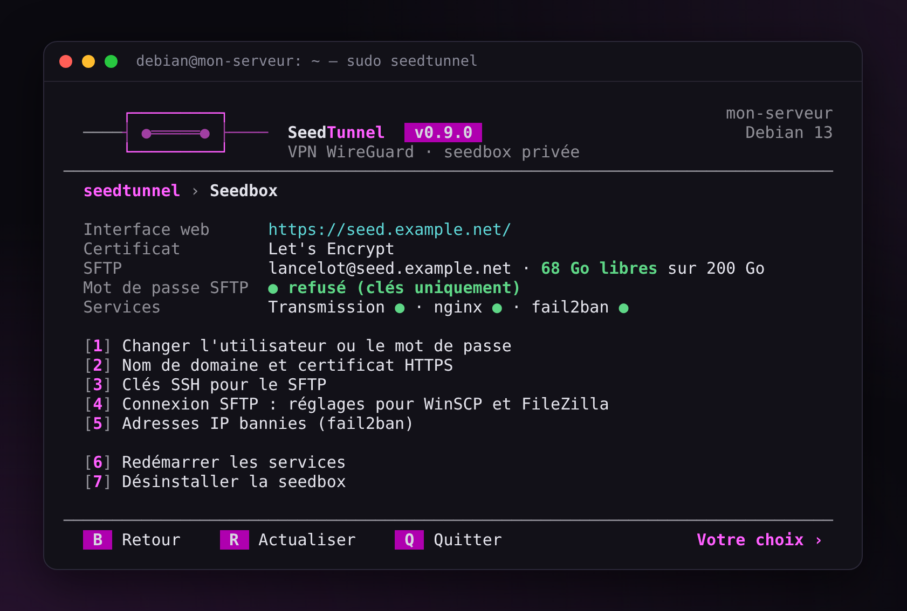
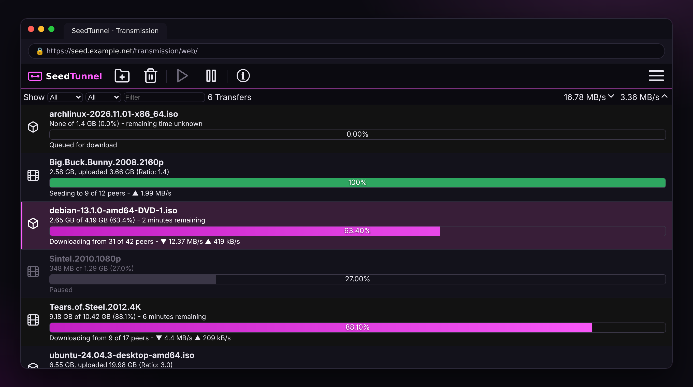
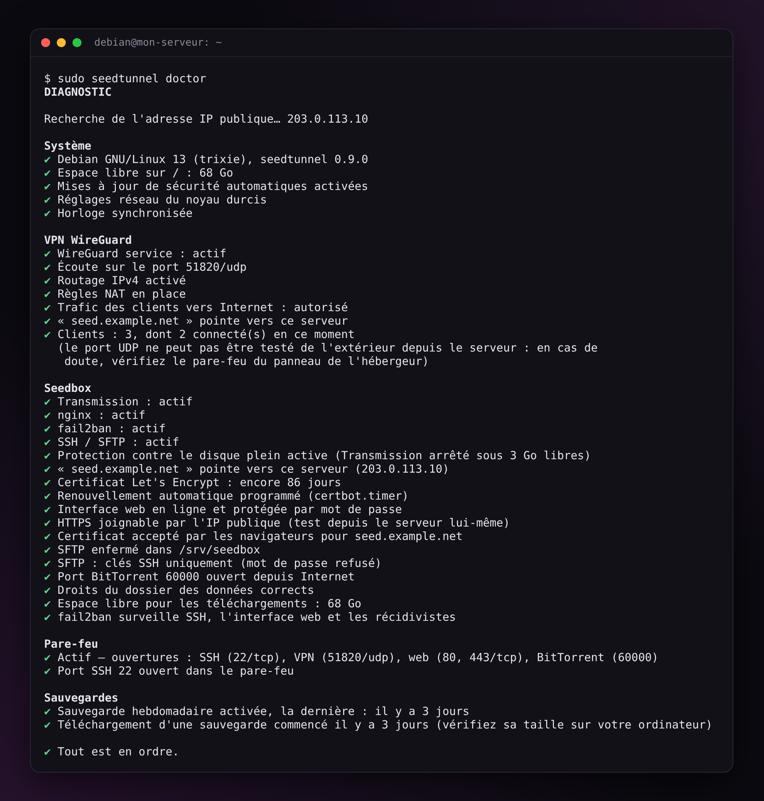

<h1 align="center">SeedTunnel</h1>

<p align="center"><b>VPN WireGuard et seedbox sécurisée sur votre propre serveur.<br>Du bash que vous pouvez lire avant de lui donner root.</b></p>

<p align="center">
  <a href="https://github.com/finalcutgit411/seedtunnel/actions/workflows/ci.yml"></a>
  <a href="https://github.com/finalcutgit411/seedtunnel/releases/latest"></a>
  <a href="LICENSE"></a>
</p>

<p align="center">Par FinalCut · <a href="README.md">English</a></p>

<p align="center"></p>

## Pourquoi lui faire confiance

Tous les scripts de seedbox se disent simples. SeedTunnel vise quelque chose de plus rare : un script que vous pouvez vérifier avant de le lancer, réparer quand quelque chose casse, et défaire.

**Vous pouvez le vérifier.**

- Du bash lisible de haut en bas : commencez par `seedtunnel.sh`, puis `lib/`. Ni Docker, ni base de données, uniquement des paquets de votre distribution.
- L'archive est contrôlée par son empreinte SHA-256 avant que rien ne soit lancé.
- Cette page liste ce que SeedTunnel change sur votre serveur, et la désinstallation le retire.

**Vous pouvez le réparer.**

- `seedtunnel doctor` passe tout le serveur en revue et donne, pour chaque problème, la commande qui le corrige.
- `seedtunnel update back` revient à la version précédente.
- Le pare-feu s'active à l'essai : ouvrez une nouvelle connexion SSH depuis votre ordinateur dans les 2 minutes, pour prouver que vous avez toujours accès. Sinon, il se retire tout seul.
- Les sauvegardes chiffrées se restaurent sur le même serveur ou sur un nouveau, même d'Ubuntu vers Debian ou l'inverse.

**Il suit les systèmes actuels.**

- Debian 12 et 13, Ubuntu Server 24.04 et 26.04.
- Chaque changement passe plus de 250 tests unitaires et une installation complète sur ces quatre systèmes.

## Est-ce pour vous ?

**Oui**, si vous louez un VPS KVM ou un serveur dédié, même petit (1 Go de RAM suffit), et que vous voulez :

- votre propre seedbox, sans y passer un week-end ;
- un VPN pour vos téléphones et ordinateurs (Wi-Fi public, famille), avec ou sans la seedbox ;
- savoir exactement ce qui tourne en root sur votre serveur.

**Non**, si vous cherchez Sonarr, Radarr, Plex et compagnie, une seedbox à plusieurs comptes, ou tout dans Docker. SeedTunnel reste petit, et c'est voulu : un Transmission, un compte SFTP, un VPN. Pour Sonarr, Radarr ou Plex, regardez plutôt [swizzin](https://swizzin.ltd/).

## Ce que vous obtenez

| | |
|---|---|
| **VPN WireGuard** | Un QR code par téléphone, un lien de téléchargement à usage unique par ordinateur (avec la seedbox), un port ouvert par client, pas de fuite IPv6. |
| **Seedbox** | Transmission derrière nginx en HTTPS, avec un certificat Let's Encrypt renouvelé tout seul (autosigné sans nom de domaine). Fichiers en SFTP, enfermés dans le dossier de la seedbox, par mot de passe ou par clé SSH, avec une clé prête pour WinSCP et FileZilla. |
| **Protection** | Pare-feu nftables, fail2ban, mots de passe gardés sous forme de hachages, mises à jour de sécurité automatiques, arrêt propre de Transmission avant que le disque soit plein. |
| **Entretien** | Diagnostic complet, sauvegardes chiffrées chaque semaine, mises à jour vérifiées avec retour arrière, et un rapport anonymisé à partager quand vous demandez de l'aide. |

<p align="center">
  
  
</p>
<p align="center">
  
  
</p>

## Installation

Sur une Debian 12/13 ou une Ubuntu Server 24.04/26.04 fraîchement installée, en root (ou après `sudo -i`) :

```bash
apt update && apt full-upgrade -y
V=0.9.0
cd "$(mktemp -d)"
curl -fLO https://github.com/finalcutgit411/seedtunnel/releases/download/v$V/seedtunnel-$V.tar.gz \
  && curl -fLO https://github.com/finalcutgit411/seedtunnel/releases/download/v$V/SHA256SUMS \
  && sha256sum -c SHA256SUMS \
  && tar -xzf seedtunnel-$V.tar.gz \
  && mv seedtunnel-$V /opt/seedtunnel \
  && /opt/seedtunnel/seedtunnel.sh
```

Sur Ubuntu, désactivez d'abord ufw (`ufw disable`) : SeedTunnel apporte son propre pare-feu.

Le menu s'ouvre à la fin. Plus tard, `seedtunnel` le rouvre.

## Au quotidien

En root, ou avec `sudo` :

| Commande | Ce qu'elle fait |
|---|---|
| `seedtunnel` | Ouvre le menu |
| `seedtunnel vpn add telephone --qr` | Ajoute un client VPN et affiche son QR code |
| `seedtunnel vpn share portable` | Crée un lien de téléchargement à usage unique pour le fichier d'un client (avec la seedbox) |
| `seedtunnel doctor` | Vérifie tout, avec la correction de chaque problème |
| `seedtunnel doctor --link` | Pareil, avec un rapport anonymisé à partager |
| `seedtunnel backup` / `backup share` | Sauvegarde chiffrée / lien de téléchargement à usage unique |
| `seedtunnel restore [FICHIER]` | Restaure une sauvegarde, sur ce serveur ou sur un nouveau (sans fichier : la liste de celles trouvées) |
| `seedtunnel update` / `update back` | Mise à jour vérifiée / retour à la version précédente |

<p align="center"></p>

## Ce qu'il change sur votre serveur

- **Paquets** : uniquement ceux de votre distribution (WireGuard, Transmission, nginx, certbot, fail2ban, nftables et quelques outils). SeedTunnel note ceux qu'il a installés et les retire à la désinstallation.
- **Un compte** : celui du SFTP de la seedbox, sans accès au shell.
- **Ses fichiers** : le code dans `/opt/seedtunnel` (la commande `seedtunnel` dans `/usr/local/bin`), les réglages dans `/etc/seedtunnel` (root seulement), le journal dans `/var/log/seedtunnel.log` (archivé chaque mois), les téléchargements dans `/srv/seedbox`, les sauvegardes dans `/var/backups/seedtunnel`.
- **Réglages du système**, dans des fichiers à son nom : WireGuard, Transmission, nginx (son site, le site par défaut désactivé), fail2ban, SSH (enfermement du compte SFTP), AppArmor (dossier de Transmission), réseau du noyau, services et minuteurs systemd (pare-feu, sauvegarde hebdomadaire, protection du disque), archivage du journal, mises à jour de sécurité automatiques.
- **Désinstallation** : retire ce que SeedTunnel a installé. Vos sauvegardes restent, et vos téléchargements aussi, sauf si vous demandez à les supprimer.

## Limites connues

- Serveurs virtuels KVM et serveurs dédiés seulement, pas les conteneurs OpenVZ ou LXC.
- Sur Ubuntu, ufw doit être désactivé (voir [Installation](#installation)).
- Docker sur le même serveur peut bloquer le trafic du VPN. `seedtunnel doctor` le détecte et dit quoi changer ; SeedTunnel ne touche jamais lui-même aux règles de Docker.

## Besoin d'aide ?

Ouvrez une [issue sur GitHub](https://github.com/finalcutgit411/seedtunnel/issues) et joignez-y le rapport de `seedtunnel doctor --link` : votre adresse IP, votre domaine et vos noms de comptes y sont remplacés.

## Documentation

- [Guide](docs/guide.fr.md) : chaque menu et chaque commande, limites connues
- [Sécurité](docs/securite.fr.md) : comment le serveur est protégé
- [Développement](docs/developpement.fr.md) : tests et traductions
- [Historique des versions](CHANGELOG.md)

## Crédits

**FinalCut** : auteur de SeedTunnel, créé en 2016 et réécrit en 2026.

## Licence

[MIT](LICENSE).
