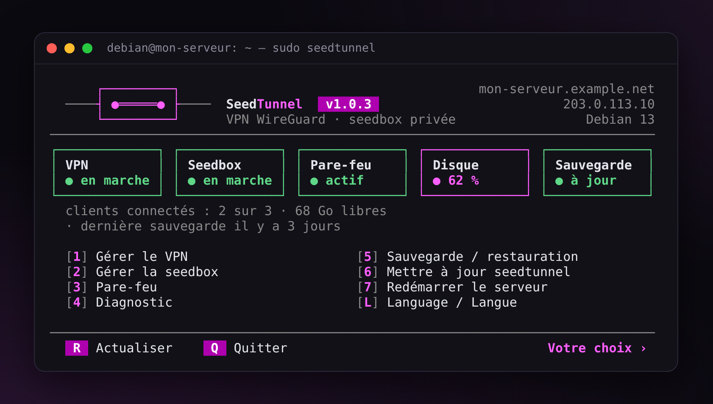
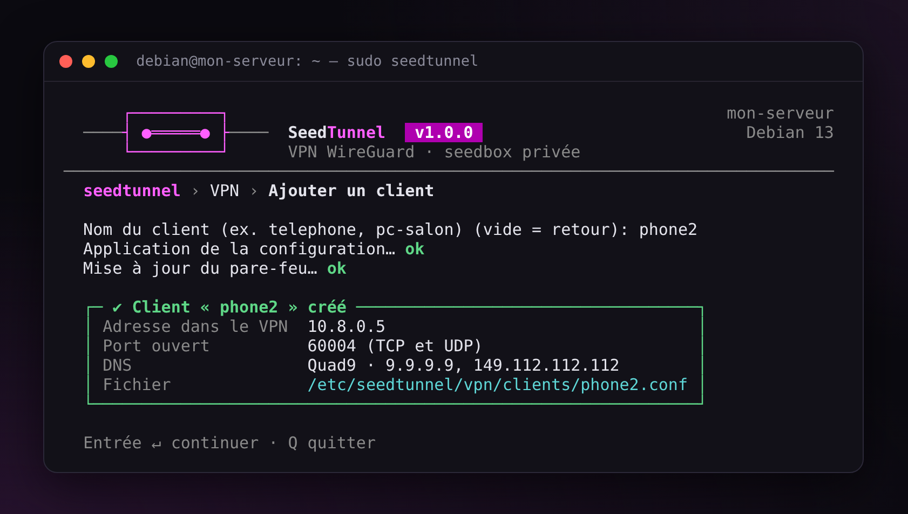
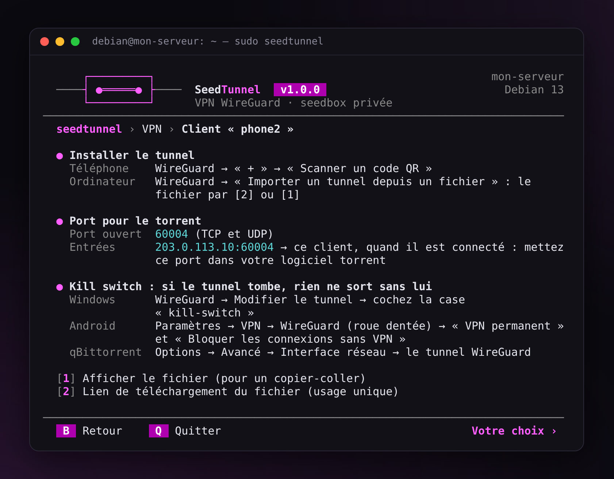
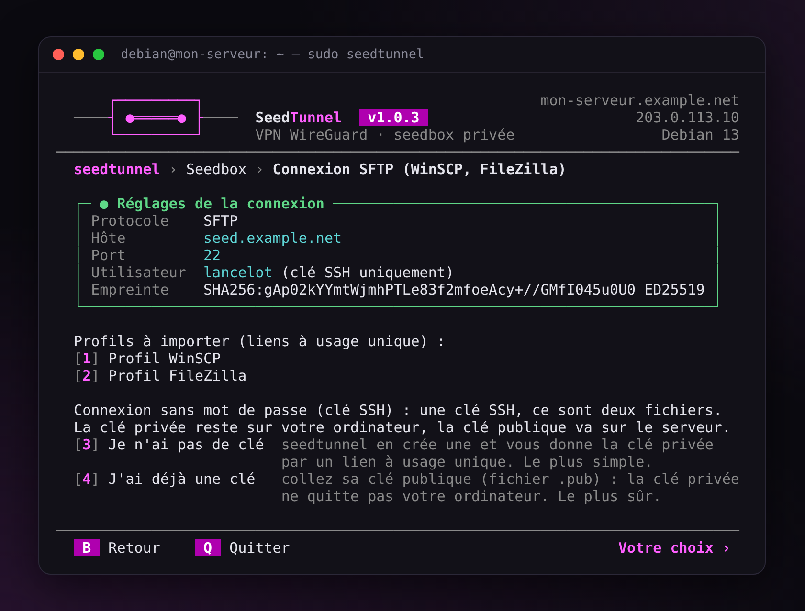
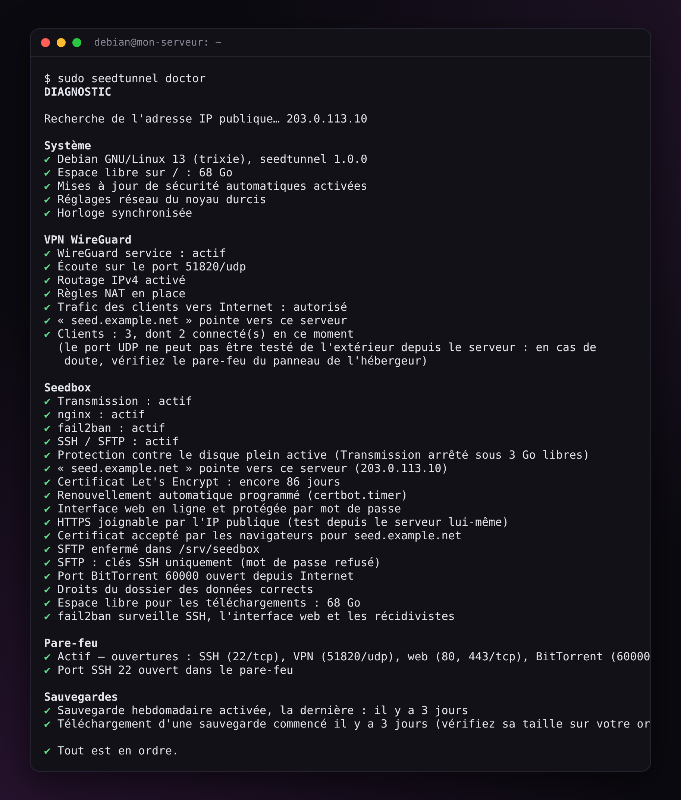

<p align="center">
  <picture>
    <source media="(prefers-color-scheme: dark)" srcset="docs/banner-fr-dark.svg">
    
  </picture>
</p>

<p align="center">
  <a href="https://github.com/finalcutgit411/seedtunnel/actions/workflows/ci.yml"></a>
  <a href="https://github.com/finalcutgit411/seedtunnel/releases/latest"></a>
  <a href="LICENSE"></a>
</p>

<p align="center">Par FinalCut · <a href="README.md">English</a></p>

**SeedTunnel** installe et gère sur votre serveur un **VPN WireGuard**, une **seedbox Transmission**, ou les deux. Tout se fait depuis un menu dans le terminal, en français ou en anglais.

<p align="center"></p>

<table>
  <tr>
    <td width="33%" valign="top"><b>Simple</b><br>Un menu, quelques touches. Ajouter un téléphone au VPN, connecter WinSCP, faire une sauvegarde : tout est guidé.</td>
    <td width="33%" valign="top"><b>Sûr</b><br>Pare-feu, HTTPS, fail2ban, sauvegardes chiffrées, SFTP enfermé dans son dossier. Rien n'est ouvert sans que vous l'ayez demandé.</td>
    <td width="33%" valign="top"><b>Léger</b><br>Du bash et les paquets de votre distribution. Ni Docker, ni base de données. 1 Go de RAM suffit.</td>
  </tr>
</table>

## Installation

**Il vous faut** un VPS KVM ou un serveur dédié sous **Debian 12 ou 13**, ou **Ubuntu Server 24.04 ou 26.04**, et un accès SSH.

**1.** Connectez-vous en SSH, puis passez en root :

```bash
sudo -i
```

**2.** Mettez le système à jour :

```bash
apt update && apt full-upgrade -y
```

**3.** Téléchargez SeedTunnel, vérifiez-le et lancez-le :

```bash
V=1.0.6
cd "$(mktemp -d)"
curl -fLO https://github.com/finalcutgit411/seedtunnel/releases/download/v$V/seedtunnel-$V.tar.gz \
  && curl -fLO https://github.com/finalcutgit411/seedtunnel/releases/download/v$V/SHA256SUMS \
  && sha256sum -c SHA256SUMS \
  && tar -xzf seedtunnel-$V.tar.gz \
  && mv seedtunnel-$V /opt/seedtunnel \
  && /opt/seedtunnel/seedtunnel.sh
```

Le menu s'ouvre. Ensuite, `sudo seedtunnel` le rouvre. Ce bloc sert une seule fois : pour les versions suivantes, c'est `sudo seedtunnel update`.

> **ufw** (le pare-feu d'Ubuntu) doit être désactivé : tant qu'il est actif, SeedTunnel n'installe rien et vous le dit. Tapez `ufw disable`, puis activez le pare-feu de SeedTunnel depuis son menu.

**Vous débutez ?** Le [guide](docs/guide.fr.md) explique tout pas à pas : le VPN sur votre téléphone, la seedbox, WinSCP, les sauvegardes.

## Ce que vous obtenez

| | |
|---|---|
| **VPN WireGuard** | Un QR code par téléphone, un lien de téléchargement par ordinateur, un port ouvert par appareil pour vos torrents. |
| **Seedbox** | Transmission dans votre navigateur, en HTTPS. Vos fichiers en SFTP, avec des profils prêts à importer dans WinSCP et FileZilla. |
| **Protection** | Pare-feu, fail2ban, mises à jour de sécurité automatiques, arrêt de Transmission avant que le disque soit plein. |
| **Entretien** | Un diagnostic complet, des sauvegardes chiffrées chaque semaine, des mises à jour vérifiées avec retour arrière. |

<p align="center">
  
  
</p>
<p align="center">
  
  
</p>

## Est-ce pour vous ?

**Oui**, si vous voulez votre seedbox ou votre VPN (Wi-Fi public, voyage, famille) sur votre propre serveur, sans y passer un week-end, et savoir ce qui tourne en root.

**Non**, si vous cherchez Sonarr, Radarr, Plex, une seedbox à plusieurs comptes ou tout dans Docker. SeedTunnel reste petit, c'est voulu. Pour ça, regardez plutôt [swizzin](https://swizzin.ltd/).

## Pourquoi lui faire confiance

- **Vous pouvez le lire.** Du bash de haut en bas : `seedtunnel.sh`, puis `lib/`. L'archive est vérifiée (SHA-256) avant d'être lancée.
- **Vous ne pouvez pas vous enfermer dehors.** Le pare-feu s'active à l'essai : sans nouvelle connexion SSH de votre part dans les 2 minutes, il se retire tout seul.
- **Vous pouvez réparer.** `seedtunnel doctor` passe le serveur en revue et donne la commande qui corrige chaque problème. `seedtunnel update back` revient à la version précédente.
- **Vous pouvez déménager.** Une sauvegarde se restaure sur un nouveau serveur, même d'Ubuntu vers Debian.
- **Il est testé.** Chaque changement passe plus de 300 tests et une installation complète sur les quatre systèmes.

<p align="center"></p>

## Au quotidien

Tout est dans le menu (`sudo seedtunnel`). Les mêmes actions existent en commandes :

| Commande | Ce qu'elle fait |
|---|---|
| `seedtunnel vpn add telephone --qr` | Ajoute un appareil au VPN et affiche son QR code |
| `seedtunnel vpn share pc-bureau` | Lien de téléchargement du fichier d'un appareil |
| `seedtunnel seedbox sftp-config winscp` | Lien vers un profil WinSCP (ou `filezilla`) |
| `seedtunnel doctor` | Vérifie tout le serveur |
| `seedtunnel backup` / `backup share` | Sauvegarde chiffrée / lien pour la télécharger |
| `seedtunnel restore` | Restaure une sauvegarde |
| `seedtunnel update` / `update back` | Mise à jour / retour à la version précédente |

Toutes les commandes : [guide, référence](docs/guide.fr.md#8-référence).

## Besoin d'aide ?

Lancez `sudo seedtunnel doctor --link` : il prépare un rapport où votre adresse IP, votre domaine et vos noms de comptes sont remplacés, et un lien pour le télécharger. Joignez-le à une [issue sur GitHub](https://github.com/finalcutgit411/seedtunnel/issues) ou à votre message sur le forum.

## Documentation

- [Guide](docs/guide.fr.md) : pas à pas, puis la référence
- [Sécurité](docs/securite.fr.md) : comment le serveur est protégé
- [Développement](docs/developpement.fr.md) : le code, les tests, les traductions
- [Historique des versions](CHANGELOG.md)

## Licence

[GPL-3.0-or-later](LICENSE) : vous pouvez utiliser, étudier, modifier et partager SeedTunnel. Une version que vous partagez, modifiée ou non, reste sous la même licence, avec son code source.

**FinalCut** : auteur de SeedTunnel, créé en 2016 et réécrit en 2026. Copyright © 2016-2026 FinalCut.
