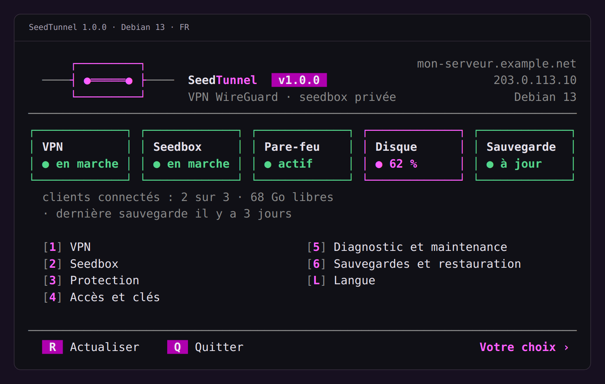

# SeedTunnel

**WireGuard + Transmission sur Debian 13.** Bash et systemd. Par **FinalCut**.

HTTPS, SFTP, pare-feu nftables, fail2ban et sauvegardes chiffrées. Interface FR/EN.



## Ce que fait SeedTunnel

- **VPN WireGuard** : clients ajoutés en une commande (QR code ou fichier),
  un port public redirigé vers chaque client, DNS au choix.
- **Seedbox Transmission** : interface web en HTTPS (Let's Encrypt), accès
  SFTP enfermé dans le dossier des données, protection contre le disque plein.
- **Protection du serveur** : pare-feu nftables qui refuse tout sauf le
  nécessaire, fail2ban, root refusé en SSH. Chaque changement risqué est mis
  à l'essai 2 minutes et annulé s'il coupe l'accès.
- **Sauvegardes chiffrées** : manuelles ou hebdomadaires, restaurables sur un
  nouveau serveur.
- **Mises à jour signées** : seule une version publiée et signée par la clé
  du projet est installée.

## Prérequis

- Un serveur dédié ou un VPS sous **Debian 13**, avec un accès root
  (`sudo -i`).
- Pour la seedbox : les ports 80 et 443 libres, et de préférence un nom de
  domaine qui pointe vers le serveur.
- Pour le VPN : un port UDP ouvert chez l'hébergeur (51820 par défaut).

## Installation

Cette commande installe la version 1.0.0 dans `/opt/seedtunnel`. Elle vérifie
d'abord la signature et l'empreinte de l'archive : la moindre différence
arrête tout, et rien n'est installé. À lancer en root :

```bash
apt-get update &&
apt-get install -y curl ca-certificates tar openssh-client &&
version=1.0.0 &&
work=$(mktemp -d) &&
cd "$work" &&
base=https://github.com/finalcutgit411/seedtunnel/releases/download/v$version &&
curl -fsSLO --proto =https --proto-redir =https "$base/seedtunnel-$version.tar.gz" &&
curl -fsSLO --proto =https --proto-redir =https "$base/SHA256SUMS" &&
curl -fsSLO --proto =https --proto-redir =https "$base/SHA256SUMS.sig" &&
echo 'seedtunnel-release namespaces="seedtunnel-release" ssh-ed25519 AAAAC3NzaC1lZDI1NTE5AAAAIIcibv00gKCrJdL9NYksnXPaA+EWcszD8s5J4wk7X1MM' >allowed_signers &&
ssh-keygen -Y verify -f allowed_signers -I seedtunnel-release -n seedtunnel-release -s SHA256SUMS.sig <SHA256SUMS &&
sha256sum -c SHA256SUMS &&
mkdir -m 755 /opt/seedtunnel &&
(umask 022 && tar --no-same-owner --no-same-permissions -xzf "seedtunnel-$version.tar.gz" --strip-components=1 -C /opt/seedtunnel) &&
cd / && rm -rf -- "$work" &&
bash /opt/seedtunnel/seedtunnel.sh
```

Attendu : `Good "seedtunnel-release" signature …`, puis
`seedtunnel-1.0.0.tar.gz: OK`, puis le menu. La clé publique ci-dessus est
celle qui signe chaque version : `seedtunnel update` utilise la même. Limite
de cette première installation : la clé vient de cette page, servie par
GitHub. Pour s'en protéger, comparez-la avec une copie obtenue par un autre
chemin. Détails : [mise à jour](docs/mise-a-jour.md).

## Utilisation

```bash
seedtunnel          # menu interactif
seedtunnel --help   # toutes les commandes
seedtunnel doctor   # diagnostic complet
```

Le menu a six rubriques : VPN, Seedbox, Protection, Accès et clés,
Diagnostic et maintenance, Sauvegardes et restauration. Chaque action existe
aussi en commande, pour les scripts. Configuration par fichier :
[exemple](examples/seedtunnel.conf).

## Documentation

- [Guide](docs/guide.md) : premiers pas, VPN, seedbox, accès SSH, pare-feu,
  diagnostic.
- [Modèle de sécurité](docs/securite.md) : ce qui est protégé, comment, et
  les limites.
- [Services tiers](docs/services-tiers.md) : les services extérieurs que le
  serveur contacte, et quand.
- [Mise à jour](docs/mise-a-jour.md) : mise à jour signée, retour à la
  version précédente, reprise après une coupure.
- [Sauvegarde et restauration](docs/sauvegarde.md).
- [Désinstallation](docs/desinstallation.md).
- [Captures des écrans](docs/screens/README.md) ; pour les voir dans votre
  terminal, sans root ni installation : `tools/preview.sh`.
- [Historique des versions](CHANGELOG.md).

## Licence

[GPL-3.0-or-later](LICENSE.txt).
