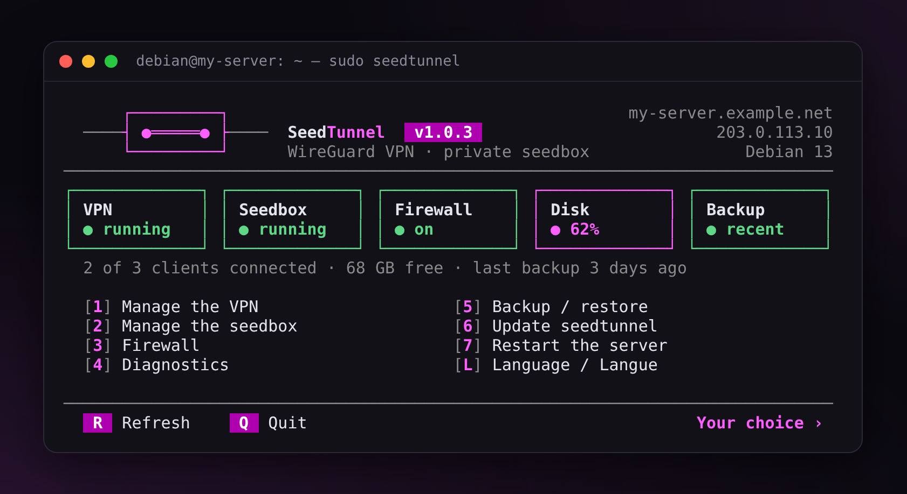
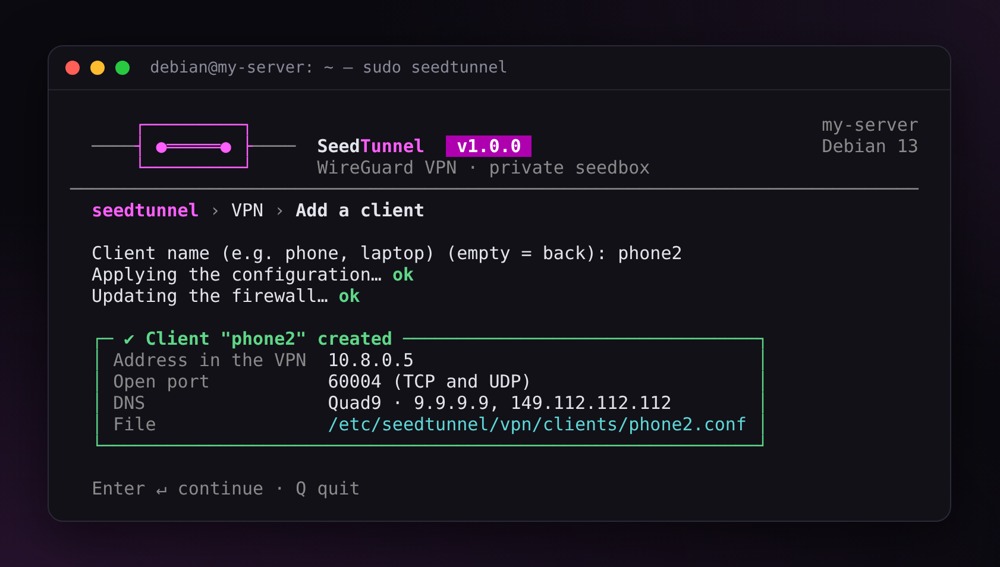
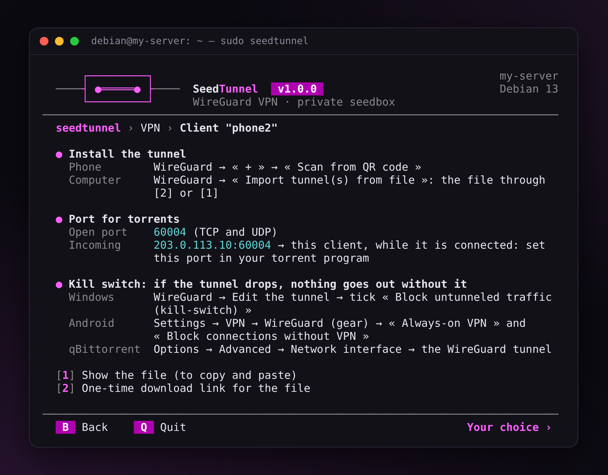
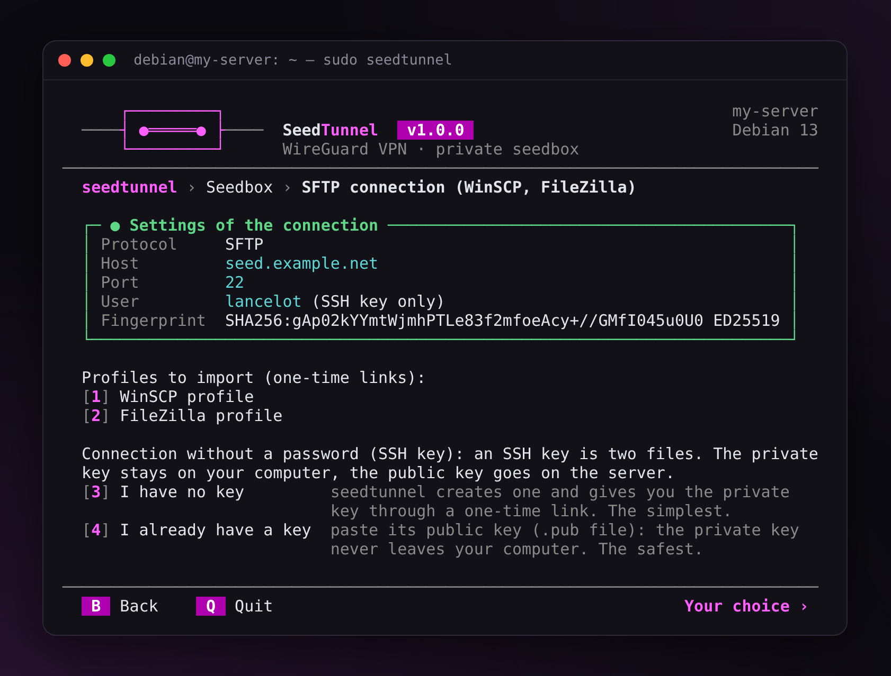
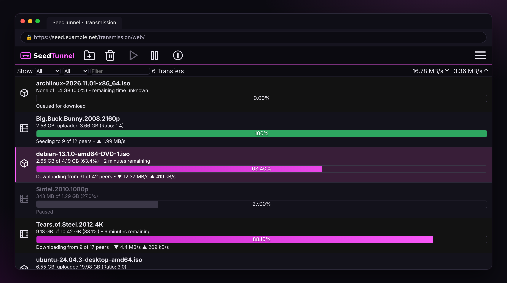
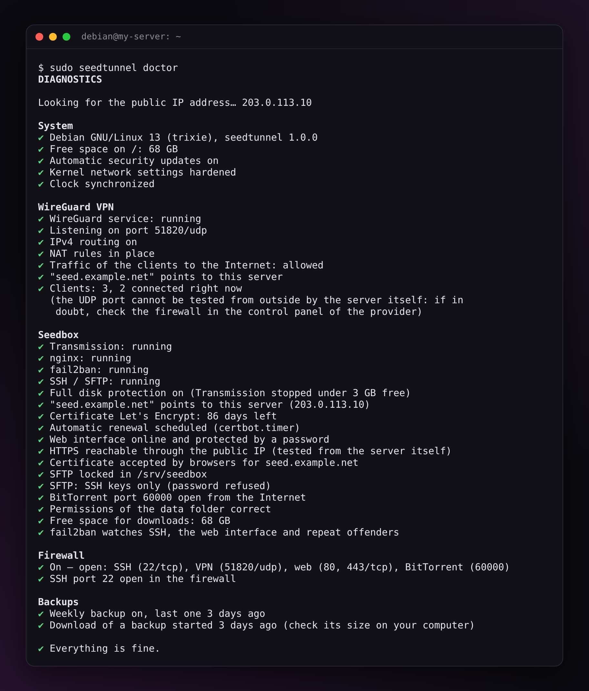

<p align="center">
  <picture>
    <source media="(prefers-color-scheme: dark)" srcset="docs/banner-en-dark.svg">
    
  </picture>
</p>

<p align="center">
  <a href="https://github.com/finalcutgit411/seedtunnel/actions/workflows/ci.yml"></a>
  <a href="https://github.com/finalcutgit411/seedtunnel/releases/latest"></a>
  <a href="LICENSE"></a>
</p>

<p align="center">By FinalCut · <a href="README.fr.md">Français</a></p>

**SeedTunnel** installs and runs a **WireGuard VPN**, a **Transmission seedbox**, or both, on your server. Everything is done from a menu in the terminal, in English or in French.

<p align="center"></p>

<table>
  <tr>
    <td width="33%" valign="top"><b>Simple</b><br>One menu, a few keys. Add a phone to the VPN, connect WinSCP, make a backup: every step is guided.</td>
    <td width="33%" valign="top"><b>Safe</b><br>Firewall, HTTPS, fail2ban, encrypted backups, SFTP locked in its folder. Nothing is open unless you asked for it.</td>
    <td width="33%" valign="top"><b>Light</b><br>Plain Bash and the packages of your distribution. No Docker, no database. 1 GB of RAM is enough.</td>
  </tr>
</table>

## Installation

**You need** a KVM VPS or a dedicated server running **Debian 12 or 13**, or **Ubuntu Server 24.04 or 26.04**, and SSH access.

**1.** Log in with SSH, then become root:

```bash
sudo -i
```

**2.** Update the system:

```bash
apt update && apt full-upgrade -y
```

**3.** Download SeedTunnel, check it and start it:

```bash
V=1.0.9
cd "$(mktemp -d)"
curl -fLO https://github.com/finalcutgit411/seedtunnel/releases/download/v$V/seedtunnel-$V.tar.gz \
  && curl -fLO https://github.com/finalcutgit411/seedtunnel/releases/download/v$V/SHA256SUMS \
  && sha256sum -c SHA256SUMS \
  && tar -xzf seedtunnel-$V.tar.gz \
  && mv seedtunnel-$V /opt/seedtunnel \
  && /opt/seedtunnel/seedtunnel.sh
```

The menu opens. Later, `sudo seedtunnel` opens it again. This block is for the first time only: for the next versions, use `sudo seedtunnel update`.

> **ufw** (the firewall of Ubuntu) must be off: while it is on, SeedTunnel installs nothing and tells you so. Type `ufw disable`, then turn on the firewall of SeedTunnel from its menu.

**New to this?** The [guide](docs/guide.md) walks you through it: the VPN on your phone, the seedbox, WinSCP, the backups.

## What you get

| | |
|---|---|
| **WireGuard VPN** | A QR code per phone, a download link per computer, an open port per device for your torrents. |
| **Seedbox** | Transmission in your browser, over HTTPS. Your files over SFTP, with profiles ready to import into WinSCP and FileZilla. |
| **Protection** | Firewall, fail2ban, automatic security updates, Transmission stopped before the disk is full. |
| **Upkeep** | A full diagnostic, encrypted backups every week, checked updates with a way back. |

<p align="center">
  
  
</p>
<p align="center">
  
  
</p>

## Is it for you?

**Yes**, if you want your seedbox or your VPN (public Wi-Fi, travel, family) on your own server, without spending a weekend on it, and you want to know what runs as root.

**No**, if you are after Sonarr, Radarr, Plex, a seedbox for several users, or everything in Docker. SeedTunnel stays small, on purpose. For that, look at [swizzin](https://swizzin.ltd/) instead.

## Why trust it

- **You can read it.** Bash from top to bottom: `seedtunnel.sh`, then `lib/`. The archive is checked (SHA-256) before it runs.
- **You cannot lock yourself out.** The firewall is turned on as a trial: without a new SSH connection from you within 2 minutes, it removes itself.
- **You can fix things.** `seedtunnel doctor` checks the whole server and gives the command that fixes each problem. `seedtunnel update back` goes back to the previous version.
- **You can move.** A backup restores on a new server, even from Ubuntu to Debian.
- **It is tested.** Every change passes more than 300 tests and a full installation on the four systems.

<p align="center"></p>

## Day to day

Everything is in the menu (`sudo seedtunnel`). The same actions exist as commands:

| Command | What it does |
|---|---|
| `seedtunnel vpn add phone --qr` | Adds a device to the VPN and shows its QR code |
| `seedtunnel vpn share laptop` | Download link for the file of a device |
| `seedtunnel seedbox sftp-config winscp` | Link to a WinSCP profile (or `filezilla`) |
| `seedtunnel doctor` | Checks the whole server |
| `seedtunnel backup` / `backup share` | Encrypted backup / link to download it |
| `seedtunnel restore` | Restores a backup |
| `seedtunnel update` / `update back` | Update / back to the previous version |

Every command: [guide, reference](docs/guide.md#8-reference).

## Need help?

Run `sudo seedtunnel doctor --link`: it makes a report where your IP address, your domain and your account names are replaced, and a link to download it. Attach it to an [issue on GitHub](https://github.com/finalcutgit411/seedtunnel/issues) or to your post on the forum.

## Documentation

- [Guide](docs/guide.md): step by step, then the reference
- [Security](docs/security.md): how the server is protected
- [Development](docs/development.md): the code, the tests, the translations
- [Changelog](CHANGELOG.md)

## License

[GPL-3.0-or-later](LICENSE): you may use, study, change and share SeedTunnel. A version you share, changed or not, stays under the same license, with its source code.

**FinalCut**: author of SeedTunnel, created in 2016 and rewritten in 2026. Copyright © 2016-2026 FinalCut.
