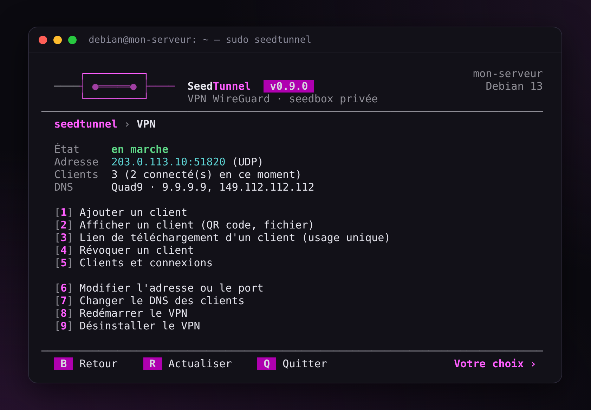
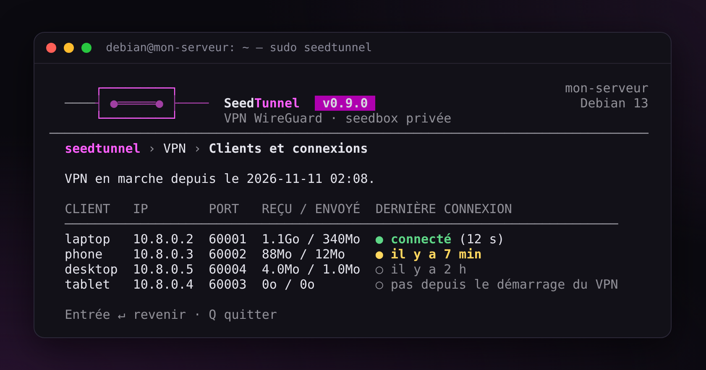
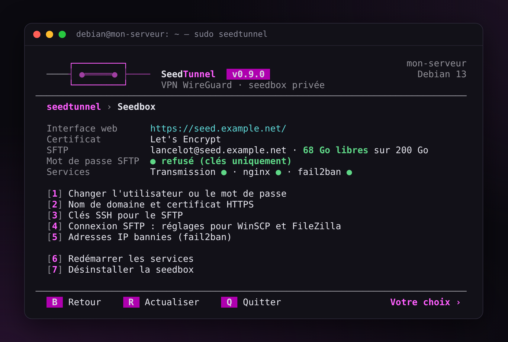
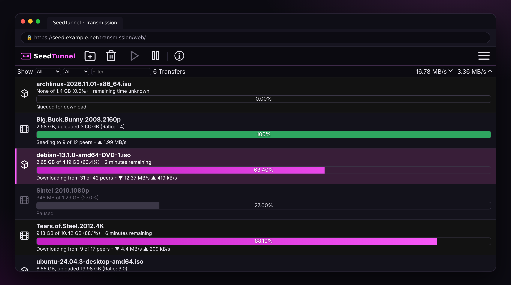
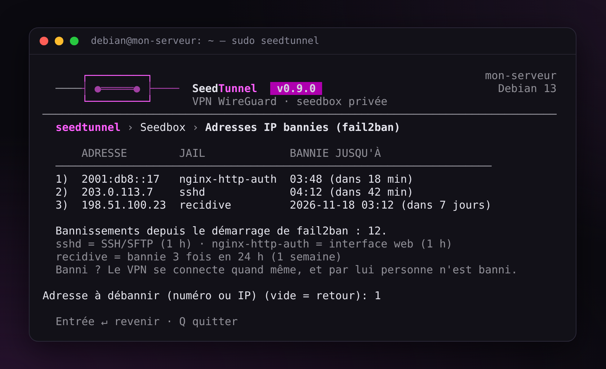
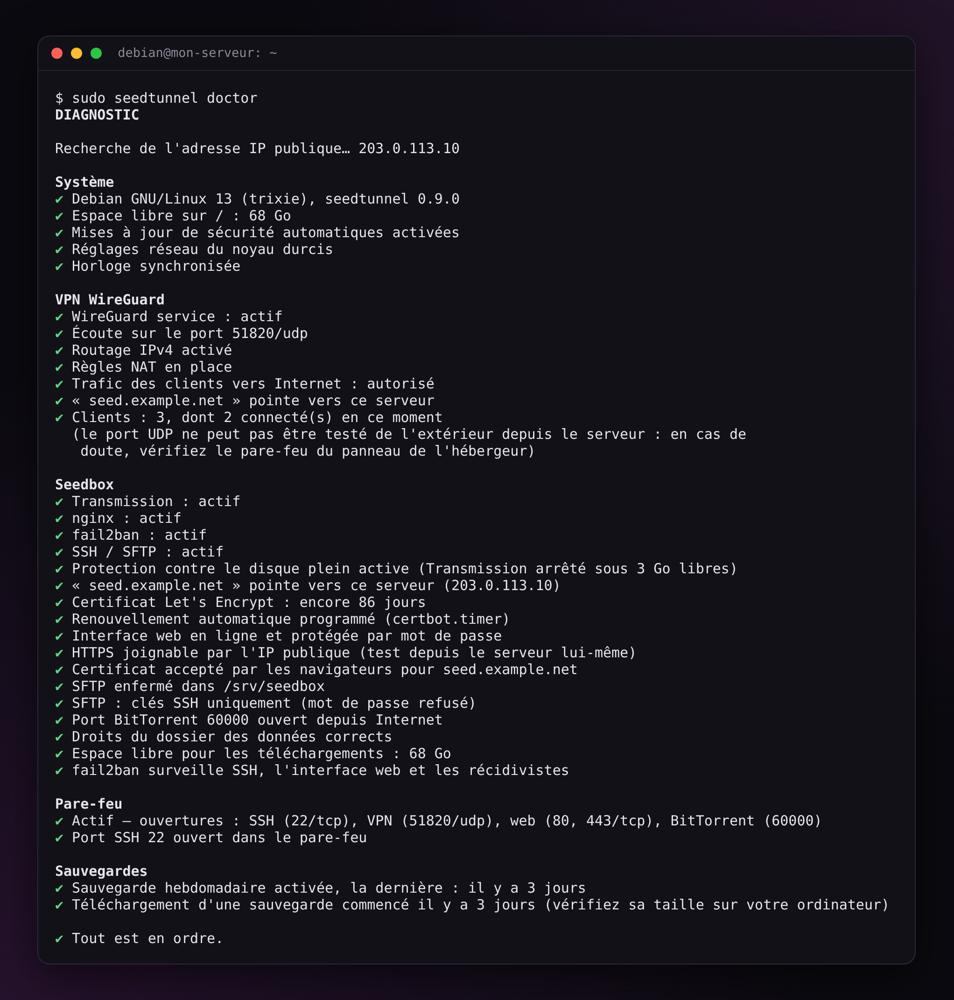

# SeedTunnel — Guide

*[English version](guide.md)* · [← Retour au README](../README.fr.md)

## Compatibilité

- Debian **12 (bookworm)** et **13 (trixie)**, Ubuntu Server **24.04** et **26.04** (LTS) : tous les quatre testés automatiquement à chaque modification. Debian 11 n'est plus pris en charge (plus de correctifs de sécurité depuis le 31 août 2026) : passez à Debian 12, puis 13 ;
- sur Ubuntu, ufw (son pare-feu) désactivé : `sudo ufw disable`. Tant qu'il est actif, seedtunnel n'installe rien, car ufw bloquerait le VPN et la seedbox ; seedtunnel a son propre pare-feu (`seedtunnel firewall enable`) ;
- VPS KVM ou serveur dédié. Les VPS en conteneur (OpenVZ, LXC) n'ont souvent pas WireGuard : le script le détecte et le signale.

## Installation

L'installation recommandée, à partir d'une version publiée, est dans le [README](../README.fr.md#installation). Ci-dessous : vérifier l'archive, installer avec git, les mises à jour et le retour en arrière.

### Vérifier l'archive

Chaque archive est aussi accompagnée d'une attestation signée par GitHub. Avec l'[outil en ligne de commande de GitHub](https://cli.github.com/), `gh attestation verify seedtunnel-$V.tar.gz --repo finalcutgit411/seedtunnel` prouve qu'elle a été fabriquée par GitHub, à partir de ce dépôt, par son processus de publication.

### Avec git

Pour suivre le développement, ou si vous préférez git :

```bash
apt update && apt full-upgrade -y && apt install -y git
git clone https://github.com/finalcutgit411/seedtunnel.git /opt/seedtunnel
/opt/seedtunnel/seedtunnel.sh
```

Dans ce cas, `seedtunnel update` passe à la dernière version publiée (étiquette `vX.Y.Z`).

Le code est fait pour être lu : n'hésitez pas à parcourir `seedtunnel.sh` et `lib/` avant de le lancer.

Ensuite, la commande `seedtunnel` relance le menu. `seedtunnel update` passe à la version suivante en vérifiant son checksum, puis réapplique la configuration pour que ses corrections prennent effet. En cas d'échec, la version précédente revient.

La version remplacée par une mise à jour est gardée dans `/opt/seedtunnel.old` (une seule). `seedtunnel update back` la remet en place, après une question qui répond « non » par défaut ; elle réapplique les réglages, et en cas d'échec la version plus récente revient. `seedtunnel update` réinstalle la version plus récente plus tard.

Si le serveur a perdu le courant pendant une mise à jour, la commande `seedtunnel` peut ne plus exister : la version installée est alors dans `/opt/seedtunnel.previous`. Pour la remettre :

```bash
mv /opt/seedtunnel.previous /opt/seedtunnel
```

Si `/opt/seedtunnel` existe aussi, `seedtunnel update` refuse de continuer tant que `/opt/seedtunnel.previous` est là. Si seedtunnel fonctionne, supprimez-le : `rm -rf /opt/seedtunnel.previous`.

## Utilisation

### Menu

`seedtunnel` sans argument donne accès à tout : VPN, seedbox, pare-feu, diagnostic, sauvegardes, mise à jour. L'accueil montre l'état du serveur en cinq blocs — VPN (clients connectés), seedbox, pare-feu, disque, sauvegarde — en vert, jaune ou rouge.

Les touches sont les mêmes dans tous les menus : `B` (ou une réponse vide) revient en arrière, `R` actualise, `Q` quitte seedtunnel. Chaque question peut se quitter avec une réponse vide : on revient en arrière, rien n'est changé. Si une action échoue, son message reste affiché et Entrée ramène au menu.

Les menus sont en bash pur : ils marchent en SSH, dans PuTTY tel quel, avec ou sans couleurs (`NO_COLOR` est respectée), et s'adaptent à la largeur de la fenêtre. Pour les voir avec des données d'exemple, sans rien installer : `bash tools/preview.sh --fr`.

<p align="center"></p>

### Commandes

```text
seedtunnel vpn install [--config FICHIER]   seedtunnel seedbox install [--config FICHIER] [--staging]
seedtunnel vpn add telephone [--qr]         seedtunnel seedbox password [--user NOM]
seedtunnel vpn remove telephone --yes       seedtunnel seedbox domain mon.domaine.fr [--staging]
seedtunnel vpn list                         seedtunnel seedbox sftp-config [filezilla]
seedtunnel vpn show telephone               seedtunnel seedbox sftp-key add ma-cle.pub
seedtunnel vpn share pc-bureau              seedtunnel seedbox sftp-key new
seedtunnel vpn dns adguard                  seedtunnel seedbox sftp-password off
                                            seedtunnel seedbox bans | unban IP
seedtunnel firewall enable|disable|status   seedtunnel doctor [--link]
seedtunnel firewall rules
seedtunnel backup [--passphrase-file F]     seedtunnel backup list | share
seedtunnel backup auto on|off|status        seedtunnel restore [FICHIER] [--passphrase-file F]
seedtunnel update                           seedtunnel apply
seedtunnel language en|fr
```

`seedtunnel help` donne le détail.

Hors terminal (dans un script), les actions destructrices demandent `--yes`. Le mot de passe se passe alors sur l'entrée standard :

```bash
printf '%s\n' "$NOUVEAU_MOT_DE_PASSE" | seedtunnel seedbox password
```

### Fichier de configuration

Tout ce que le menu demande peut être écrit dans un fichier. Le modèle commenté est dans `examples/seedtunnel.conf`.

```bash
cp /opt/seedtunnel/examples/seedtunnel.conf /root/serveur.conf && chmod 600 /root/serveur.conf
nano /root/serveur.conf
seedtunnel vpn install --config /root/serveur.conf
seedtunnel seedbox install --config /root/serveur.conf
```

L'installation est **idempotente** : relancée avec le même fichier, elle ne change rien et ne redémarre aucun service. Si quelque chose a été modifié à la main, elle remet tout en ordre, garde une copie de ce qui avait été modifié dans `/etc/seedtunnel/changed-by-hand/`, et le dit (`seedtunnel doctor` aussi).

Le fichier n'est jamais exécuté : il est seulement lu ligne par ligne, et les clés inconnues sont refusées.

### Langue

À la première ouverture, le menu demande la langue : anglais ou français. Pour en changer ensuite : `seedtunnel language fr` (ou `en`), ou `L` dans le menu. La clé `LANGUAGE` du fichier de configuration fait de même, et `SEEDTUNNEL_LANG=fr` dans l'environnement la change pour une seule commande.

## Ce que fait le script

### VPN

| | |
|---|---|
| Réseau | 10.8.0.0/24, serveur en 10.8.0.1 |
| Port | 51820/UDP par défaut |
| Clients | jusqu'à 253, nommés, révocables, appliqués à chaud |
| Port ouvert | le client n°N reçoit le port 60000+N en TCP et UDP |
| Fuites | tout le trafic IPv4 et IPv6 du client passe par le tunnel, tant que le tunnel est en place (voir le kill switch plus bas) |
| Récupération | QR code pour les téléphones, ou lien de téléchargement à usage unique pour les ordinateurs |
| DNS des clients | Quad9 par défaut ; Cloudflare, DNS4EU (Union européenne), AdGuard (bloque aussi les publicités) ou vos propres adresses. Pour le changer : menu VPN → « Changer le DNS des clients », ou `seedtunnel vpn dns adguard`. Chaque client garde l'ancien jusqu'à ce qu'il réimporte sa configuration |
| Connexions | « Clients et connexions » : connecté (vert), il y a moins d'une heure (jaune), plus ancien, ou pas depuis le démarrage du VPN (WireGuard les oublie quand il redémarre) |

<p align="center"></p>

### Seedbox

| | |
|---|---|
| Interface web | `https://votre-domaine/` (identifiant + mot de passe), aux couleurs de seedtunnel (Transmission 3 et 4). Après « Annuler » ou un mauvais mot de passe, une page « Accès refusé » sobre : aucun nom, rien sur ce qu'il y a derrière |
| Fichiers | SFTP (WinSCP, FileZilla, Cyberduck), mot de passe et/ou clés SSH ; réglages prêts à importer avec `seedtunnel seedbox sftp-config` |
| Certificat | Let's Encrypt, ou auto-signé si aucun nom de domaine ne pointe sur le serveur |
| Dossiers | `watch/` (déposez un .torrent), `incomplete/`, `complete/`, `documents/` |
| Protection | fail2ban sur SSH/SFTP, le mot de passe web et les récidivistes. Les adresses bannies en ce moment, avec la fin de leur bannissement : menu Seedbox → « Adresses IP bannies », ou `seedtunnel seedbox bans` |
| Disque plein | contrôlé toutes les 5 minutes : sous 3 Go libres, Transmission est arrêté proprement ; il redémarre tout seul au-dessus de 5 Go |

<p align="center"></p>

<p align="center"></p>

Pas de nom de domaine ? La plupart des hébergeurs en fournissent un (par exemple `vps-1234abcd.vps.ovh.net`). Le script le propose s'il pointe bien sur le serveur.

Pour vos essais, `--staging` utilise les serveurs de test de Let's Encrypt. Leurs limites sont bien plus hautes, mais leur certificat n'est pas reconnu par les navigateurs.

### Liens de téléchargement à usage unique

Plus besoin de `scp` pour récupérer un fichier sur son ordinateur :

- `seedtunnel vpn share pc-bureau` donne un lien vers la configuration WireGuard du client ;
- `seedtunnel backup share` donne un lien vers la dernière sauvegarde ;
- `seedtunnel seedbox sftp-config` donne une adresse à coller dans WinSCP, qui contient l'empreinte du serveur : WinSCP vérifie tout seul que c'est le bon serveur, sans question à la première connexion. Avec `filezilla`, elle crée en plus un lien vers un fichier à importer dans FileZilla ;
- `seedtunnel seedbox sftp-key new` crée une clé SSH et donne un lien vers elle au format .ppk, prête pour WinSCP et FileZilla : SFTP sans mot de passe. Aucune copie de la clé privée ne reste sur le serveur.

Le lien passe par le site HTTPS de la seedbox. Il contient un jeton aléatoire impossible à deviner, ne fonctionne **qu'une fois** et expire au bout de **10 minutes**. nginx ne sert le fichier qu'une fois : toute autre requête est refusée, même juste après sur la même connexion ou avec une autre forme de l'adresse, jamais de téléchargement partiel, et le fichier est aussitôt supprimé. Une requête HEAD est refusée sans consommer le lien. Ouvrir la page ne compte pas, seul le téléchargement du fichier compte : l'aperçu automatique d'une messagerie ne gâche donc pas le lien.

Le jeton est masqué dans le journal de nginx (`/share/<jeton>/…`) : le journal dit toujours qui a téléchargé, quand, et si cela a marché.

### Pare-feu

`seedtunnel firewall enable` refuse tout ce qui arrive sur le serveur, sauf :
- SSH, sur le port réellement utilisé ;
- le VPN et la seedbox s'ils sont installés ;
- l'ICMP indispensable à IPv6.

Cela concerne ce qui arrive sur le serveur lui-même. Les clients du VPN sont considérés comme de confiance : ce qui vient d'eux par le tunnel est accepté.

Dans un terminal, chaque changement est d'abord **à l'essai** : sans confirmation depuis une nouvelle connexion SSH dans les 2 minutes, les règles précédentes reviennent (ou aucune règle, la première fois). « oui » ne compte qu'une fois que sshd a accepté une nouvelle connexion depuis l'application des règles : depuis Internet, elle compte toujours ; par le VPN, seulement si votre session passe aussi par le VPN ; depuis le serveur lui-même, jamais. Une confirmation depuis Internet ne prouve rien pour le VPN : son port est vérifié par les tests automatiques, avec un nouveau tunnel à travers le pare-feu. Les règles chargées au démarrage ne changent qu'après confirmation.

`seedtunnel firewall rules` (ou « Afficher les règles » dans le menu) liste en clair les règles que nftables a réellement chargées en ce moment, et les ports redirigés vers chaque client VPN (ils sont joignables depuis Internet). Ce qui diffère des réglages est signalé. Les règles brutes peuvent aussi être affichées.

### Banni de SSH ? Revenez par le VPN

Avec la seedbox, fail2ban bannit une adresse après 5 connexions ratées en 10 minutes : pour 1 heure, et pour 1 semaine après 3 bannissements en 24 heures. La vôtre aussi, quand vous vous trompez ou faites des tests. Le bannissement ferme tous les ports TCP (SSH, SFTP, l'interface web), mais pas le VPN, qui passe en UDP ; et les adresses du VPN (10.8.0.x) ne sont jamais bannies. Donc, depuis l'ordinateur banni :

1. allumez le VPN ;
2. `ssh votre-utilisateur@10.8.0.1` : le serveur, par le tunnel ;
3. `sudo seedtunnel`, puis Seedbox → « Adresses IP bannies » : votre adresse et la fin de son bannissement ; tapez son numéro pour la débannir (ou `sudo seedtunnel seedbox unban IP`).

Votre adresse n'est pas dans la liste ? Cherchez une adresse IPv6 : beaucoup de connexions à la maison joignent le serveur en IPv6.

<p align="center"></p>

### Diagnostic

`seedtunnel doctor` vérifie, avec pour chaque problème la commande qui le corrige :
- les services, et qu'ils redémarreront bien avec le serveur ;
- le DNS ;
- l'expiration du certificat et son renouvellement ;
- les ports et le pare-feu, dont le port SSH : un port changé sans mettre le pare-feu à jour vous enfermerait dehors ; que le pare-feu refuse bien ce qui n'est pas autorisé ;
- le NAT du VPN, fait pour la carte réseau qu'utilise le serveur aujourd'hui ;
- que le trafic des clients du VPN peut traverser le serveur : le pare-feu d'un autre programme (Docker surtout) qui le refuse par défaut laisse les clients se connecter sans Internet (voir « Limites connues ») ;
- les réglages réseau du noyau (IPv4, et IPv6 si le serveur l'a) ;
- l'espace disque, la protection contre le disque plein (dont un Transmission qui ne redémarre pas alors qu'il y a de la place) et l'horloge ;
- une mise à jour ou une restauration qui ne s'est pas terminée, et les réglages qu'une restauration terminée a remplacés, encore gardés ;
- un redémarrage conseillé : un noyau installé depuis le démarrage du serveur et pas encore utilisé ;
- les sauvegardes (voir plus bas), dont le minuteur et la passphrase de la sauvegarde hebdomadaire ;
- le port BitTorrent vu d'Internet, par le service de test de Transmission (fermé : vérifiez le pare-feu de votre hébergeur, comme l'« Edge Network Firewall » chez OVH) ;
- le mot de passe SFTP : un avertissement quand il est encore autorisé alors que vous avez une clé SSH.

Il renvoie le code 1 s'il trouve un problème : il peut tourner dans une tâche planifiée.

<p align="center"></p>

Tout ce que seedtunnel lance est écrit dans `/var/log/seedtunnel.log` (lisible par root seulement, jamais de mot de passe). Il est découpé chaque mois par logrotate ; les 6 derniers mois sont gardés, compressés. Avec moins de 100 Mo libres sur le disque système, seedtunnel ne change rien et le dit d'abord.

Pour demander de l'aide, `seedtunnel doctor --link` (ou la question à la fin du diagnostic, dans le menu) prépare un **rapport** — le diagnostic et la fin du journal — et un lien à usage unique pour l'envoyer. Ce qui est privé est remplacé par un terme générique : domaine, nom du serveur, adresses IP publiques, compte SFTP, clés SSH, noms des clients VPN (`<client-1>`…). Les ports et les adresses internes du VPN (10.8.0.x, les mêmes sur tous les serveurs) restent. Il ne contient jamais de mot de passe, de passphrase ni de clé. Sans seedbox, le rapport est enregistré dans votre dossier personnel.

### Sauvegardes

`seedtunnel backup` crée une archive chiffrée (AES-256) dans `/var/backups/seedtunnel`, contenant :
- les clés et clients du VPN ;
- les réglages et hash des mots de passe de la seedbox ;
- les certificats et les clés SSH du SFTP ;
- le pare-feu ;
- la liste des torrents et les réglages de Transmission.

Si un réglage change pendant l'écriture de l'archive (renouvellement d'un certificat, par exemple), l'archive est refaite, jusqu'à 3 fois : une sauvegarde ne mélange jamais anciens et nouveaux réglages. Un fichier existant n'est jamais remplacé : `--output` refuse un nom déjà pris.

`seedtunnel backup auto on` fait une sauvegarde chiffrée **chaque semaine** et garde les 4 dernières. Sa passphrase est enregistrée sur le serveur (lisible par root uniquement) pour qu'elle tourne seule : notez-la aussi ailleurs. La désactiver (`seedtunnel backup auto off`, ou le menu) demande d'abord confirmation : la passphrase enregistrée est effacée.

Une sauvegarde restée sur le serveur disparaît avec lui : `seedtunnel backup share` donne un lien à usage unique pour télécharger la dernière sur votre ordinateur. `seedtunnel doctor` vous le rappelle quand la sauvegarde hebdomadaire est désactivée ou échoue, et quand aucune sauvegarde n'a été téléchargée depuis un mois.

Dans le menu (Sauvegarde / restauration → « Restaurer une sauvegarde »), les sauvegardes du serveur et celles copiées dans `/root` ou un dossier personnel (WinSCP, scp) sont listées, la plus récente d'abord : tapez un numéro, ou le chemin d'un autre fichier. `seedtunnel restore` sans fichier affiche la même liste.

Sur un serveur neuf, `seedtunnel restore FICHIER` remet tout en place, Debian ou Ubuntu : une sauvegarde faite sur un autre système (ou une autre version) est signalée, et restaurée de la même façon : chacun des quatre systèmes a été restauré sur les autres, sur de vrais serveurs. L'archive est d'abord vérifiée, pour qu'une sauvegarde faite par quelqu'un d'autre ne puisse rien lancer : seulement des fichiers et des dossiers (et les liens de Let's Encrypt), aucun qui puisse être exécuté, des fichiers de réglages qui ne peuvent lancer aucune commande et ne contiennent que les réglages de seedtunnel, avec des valeurs qu'il accepterait à une installation. De Let's Encrypt, seuls le certificat de seedtunnel et son compte reviennent, et son fichier de renouvellement ne peut lancer que le rechargement de nginx : les autres certificats du serveur ne sont pas touchés. Les clients VPN se reconnectent sans rien changer si `VPN_PUBLIC_ADDRESS` est un nom de domaine qui pointe vers le nouveau serveur.

Sur un serveur qui a déjà seedtunnel, la sauvegarde doit lui correspondre, ce qui est vérifié avant de rien remplacer : un VPN ou une seedbox du serveur absent de la sauvegarde, un autre compte SFTP que celui de la seedbox, ou un compte de la sauvegarde qui existe déjà sur le serveur, et la restauration s'arrête en disant quoi faire. Le pare-feu et la sauvegarde hebdomadaire du serveur restent actifs si la sauvegarde n'en a pas. Une restauration coupée net (coupure de courant) est signalée par `seedtunnel doctor` et par le menu, avec le moyen de revenir en arrière : une commande remet les réglages, les clés SSH du SFTP, le certificat et la liste des torrents d'avant. Une fois la restauration terminée, les réglages qu'elle a remplacés restent dans `/etc/seedtunnel.before-restore-…` (anciennes clés, mots de passe, passphrase) : la fin de la restauration et `seedtunnel doctor` donnent la commande pour les supprimer quand tout marche. Un serveur neuf n'a rien à mettre de côté.

Les fichiers téléchargés ne sont pas dans la sauvegarde. À la restauration, les torrents reviennent par `watch/`, comme des nouveaux : Transmission vérifie chacun avec les fichiers déjà présents dans le dossier des données avant de le démarrer, et continue à partir de là (depuis zéro sans eux). Pour changer de serveur : copiez d'abord les téléchargements, puis restaurez :

```bash
rsync -a --info=progress2 ancien-serveur:/srv/seedbox/complete/ /srv/seedbox/complete/
```

Recopiés après la restauration, vérifiez les torrents dans l'interface web (sélectionnez-les, clic droit → « Verify Local Data »). Non gardés : les pauses, les fichiers décochés dans un torrent, les statistiques (envoyé, ratio). Cela marche entre toutes les versions de Transmission, y compris une sauvegarde d'Ubuntu 26.04 (Transmission 4.1) restaurée sur Debian 12 (Transmission 3). Les torrents ajoutés par un lien magnet, encore sans leurs métadonnées, reviennent aussi, par `watch/` avec Transmission 4 ; Transmission 3 (Debian 12) ne sait pas les y lire : leurs liens sont enregistrés dans `/root/seedtunnel-magnets.txt`, à ajouter à nouveau dans l'interface web.

## Limites connues

- **WireGuard ne fonctionne qu'en UDP.** Sur un réseau qui bloque l'UDP, essayez le port 443 en UDP : il est souvent ouvert, car HTTP/3 l'utilise.
- **Le VPN est en IPv4 uniquement.** L'IPv6 des clients est bloqué dans le tunnel plutôt que de fuiter.
- **Si le tunnel tombe, le client sort sans lui**, avec sa vraie adresse : le serveur n'y peut rien, c'est au client de l'empêcher. Pour bloquer tout ce qui passe hors du tunnel (kill switch) :
  - Windows : application WireGuard → Modifier le tunnel → cochez la case « kill-switch » ;
  - Android : Paramètres → VPN → WireGuard (roue dentée) → « VPN permanent » et « Bloquer les connexions sans VPN » ;
  - qBittorrent (tout système) : Options → Avancé → Interface réseau → le tunnel WireGuard : pas de tunnel, pas de téléchargement.
- **La seedbox est mono-utilisateur.**
- **Docker sur le même serveur peut couper le VPN d'Internet.** À son démarrage, Docker peut refuser par défaut le trafic qui traverse le serveur : les clients se connectent, mais rien ne revient. `seedtunnel doctor` le voit. Pour de bon, ajoutez `"ip-forward-no-drop": true` dans `/etc/docker/daemon.json` (si le fichier n'existe pas : `{ "ip-forward-no-drop": true }`) et vérifiez-le avec `sudo dockerd --validate --config-file /etc/docker/daemon.json` ; il compte à partir du prochain redémarrage du serveur. D'ici là (`ens3` : la carte réseau de votre serveur, donnée par `ip route show default`) :
  ```
  sudo iptables -I DOCKER-USER -i wg0 -o ens3 -j ACCEPT
  sudo iptables -I DOCKER-USER -i ens3 -o wg0 -m conntrack --ctstate RELATED,ESTABLISHED,DNAT -j ACCEPT
  ```

## Désinstallation

`seedtunnel seedbox uninstall`, `seedtunnel vpn uninstall`, `seedtunnel firewall disable`, ou les options du menu.

Les données téléchargées sont conservées, sauf avec `--purge-data`. Les sauvegardes restent dans `/var/backups/seedtunnel`. Seuls les paquets installés par seedtunnel sont supprimés (listés dans `/etc/seedtunnel/packages`) : un nginx déjà là avant, par exemple, reste. La suppression est d'abord simulée (`apt-get -s`) : si elle emportait aussi un paquet que seedtunnel n'a pas installé, rien n'est supprimé et les paquets concernés sont nommés.
