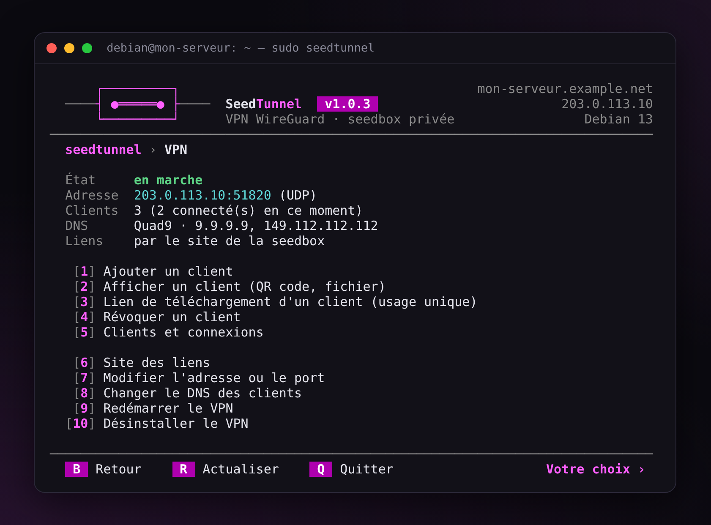
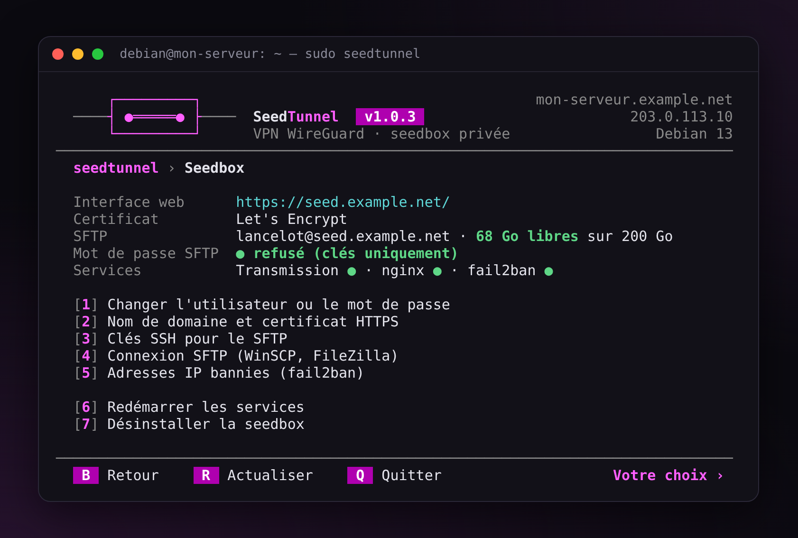
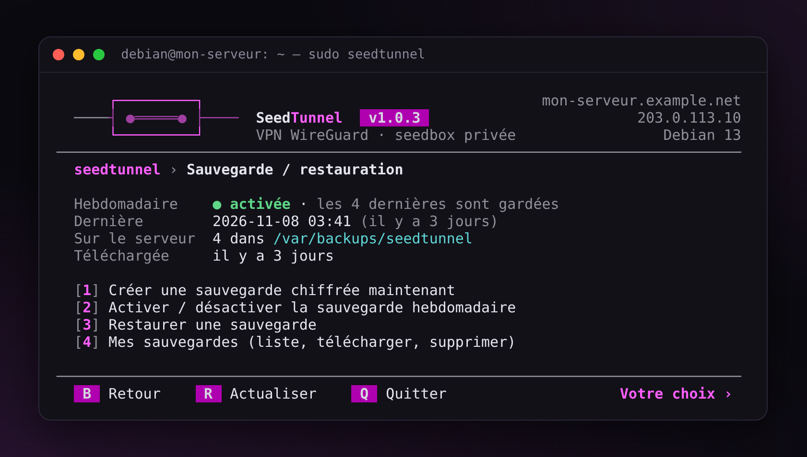
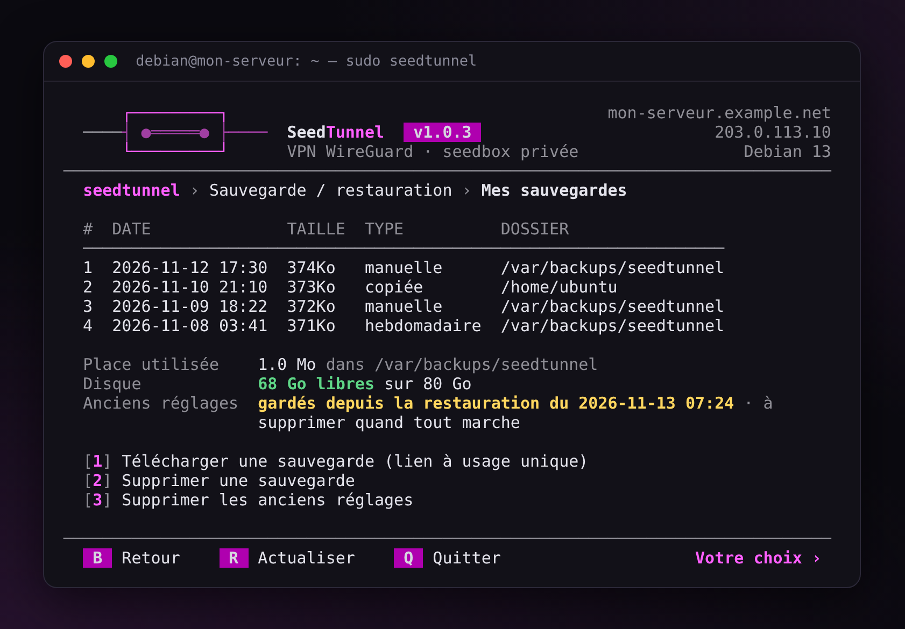
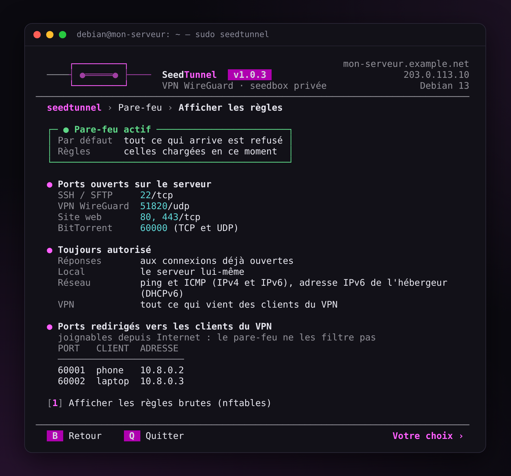
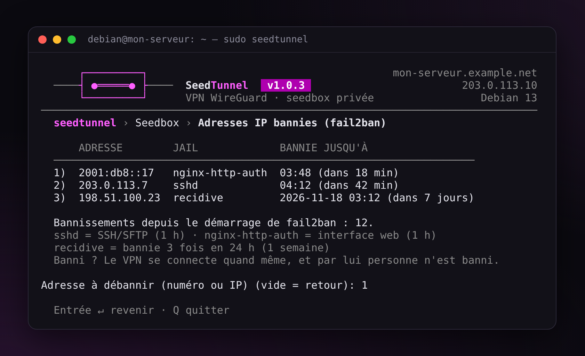

# SeedTunnel — Guide

*[English version](guide.md)* · [← Retour au README](../README.fr.md)

Ce guide va droit au but : chaque partie dit quoi faire, dans le menu. Les commandes équivalentes sont à la fin, dans la [référence](#8-référence).

1. [Avant de commencer](#1-avant-de-commencer)
2. [Installer](#2-installer)
3. [Le VPN](#3-le-vpn)
4. [La seedbox](#4-la-seedbox)
5. [Récupérer vos fichiers (SFTP)](#5-récupérer-vos-fichiers-sftp)
6. [Entretien : diagnostic, sauvegardes, mises à jour, pare-feu](#6-entretien--diagnostic-sauvegardes-mises-à-jour-pare-feu)
7. [En cas de problème](#7-en-cas-de-problème)
8. [Référence](#8-référence)

## 1. Avant de commencer

- **Un serveur** : un VPS KVM ou un serveur dédié, sous Debian 12 ou 13, ou Ubuntu Server 24.04 ou 26.04. 1 Go de RAM suffit ; pour une seedbox, prévoyez surtout de la place sur le disque. Les VPS en conteneur (OpenVZ, LXC) n'ont souvent pas WireGuard : SeedTunnel le détecte et le dit.
- **Un accès SSH** : l'adresse du serveur, un compte et son mot de passe (ou sa clé), donnés par l'hébergeur. Sous Windows, PuTTY ou le Terminal font l'affaire : `ssh debian@ADRESSE-DU-SERVEUR`.
- **Un nom de domaine**, si possible. Il permet un vrai certificat HTTPS et un VPN qui suit le serveur s'il change d'adresse. Pas de domaine ? La plupart des hébergeurs en donnent un (par exemple `vps-1234abcd.vps.ovh.net`) : SeedTunnel le propose s'il pointe bien sur le serveur.
- **ufw** (le pare-feu d'Ubuntu) doit être désactivé. Tant qu'il est actif, SeedTunnel n'installe rien et vous le dit : tapez `ufw disable`, puis activez le pare-feu de SeedTunnel (voir [Pare-feu](#pare-feu)).

## 2. Installer

Connectez-vous en SSH, puis :

```bash
sudo -i
apt update && apt full-upgrade -y
V=1.0.6
cd "$(mktemp -d)"
curl -fLO https://github.com/finalcutgit411/seedtunnel/releases/download/v$V/seedtunnel-$V.tar.gz \
  && curl -fLO https://github.com/finalcutgit411/seedtunnel/releases/download/v$V/SHA256SUMS \
  && sha256sum -c SHA256SUMS \
  && tar -xzf seedtunnel-$V.tar.gz \
  && mv seedtunnel-$V /opt/seedtunnel \
  && /opt/seedtunnel/seedtunnel.sh
```

`sha256sum -c` doit répondre `OK` : sinon, l'archive n'est pas lancée.

Le menu s'ouvre et demande d'abord la langue. Plus tard, `sudo seedtunnel` le rouvre.

<p align="center"></p>

L'accueil montre l'état du serveur en cinq blocs : vert, ça va ; jaune, à surveiller ; rouge, un problème. Dans tous les menus, tapez le numéro d'un choix, `B` pour revenir, `Q` pour quitter. Une réponse vide à une question revient en arrière sans rien changer.

## 3. Le VPN

### Installer le VPN

Accueil → `[1] Installer le VPN`. Il demande :

1. **l'adresse du serveur** : celle proposée (son IP) convient ; un nom de domaine est encore mieux ;
2. **le port** : gardez `51820` ;
3. **le nom du premier appareil**, par exemple `telephone`.

### Connecter un téléphone

Installez l'application **WireGuard** (Play Store, App Store). Le QR code du téléphone s'affiche seul à l'écran : dans l'application, `+` → « Scanner un code QR ». Fenêtre trop petite pour le QR code ? Agrandissez-la, puis `R`.

<p align="center"></p>

### Connecter un ordinateur

1. Menu VPN → `[1] Ajouter un client`, par exemple `pc-bureau`.
2. Sur l'écran de l'appareil, `[2] Lien de téléchargement du fichier`.
3. Ouvrez le lien sur l'ordinateur, téléchargez le fichier `.conf`.
4. Application WireGuard → « Importer un tunnel depuis un fichier » → ce fichier.

Le lien ne marche **qu'une fois** et dure **10 minutes**.

Sans seedbox, le premier lien propose d'installer un petit site HTTPS qui ne sert qu'aux liens (ports 80 et 443) : répondez Entrée. Sans nom de domaine, son certificat est « auto-signé » : le navigateur affiche un avertissement. Vérifiez que l'empreinte SHA-256 donnée par SeedTunnel est la même que celle du navigateur, puis acceptez.

<p align="center"></p>

### Vérifier

VPN allumé, ouvrez un site qui affiche votre adresse IP : vous devez voir celle du serveur.

### Bon à savoir

- **Un appareil = un client.** Perdu ou volé : menu VPN → `[4] Révoquer un client`.
- **`[5] Clients et connexions`** : qui est connecté en ce moment.
- **Un port pour vos torrents** : chaque appareil reçoit un port ouvert (60001, 60002…), affiché sur son écran. Mettez-le dans votre logiciel torrent.
- **Kill switch** : si le tunnel tombe, l'appareil sort avec sa vraie adresse. Pour l'empêcher : Windows, WireGuard → Modifier le tunnel → case « kill-switch » ; Android, Paramètres → VPN → WireGuard → « VPN permanent » et « Bloquer les connexions sans VPN » ; qBittorrent, Options → Avancé → Interface réseau → le tunnel.
- **DNS** : Quad9 par défaut. `[8] Changer le DNS des clients` propose aussi Cloudflare, DNS4EU et AdGuard (qui bloque les pubs). Chaque appareil doit ensuite réimporter son fichier.

<p align="center"></p>

## 4. La seedbox

### Installer la seedbox

Accueil → `[2] Installer la seedbox`. Il demande :

1. **un nom d'utilisateur et un mot de passe** : pour l'interface web et pour le SFTP ;
2. **le nom de domaine** (ou l'IP) : avec un domaine qui pointe sur le serveur, le certificat vient de Let's Encrypt et se renouvelle tout seul ; avec l'IP, il est auto-signé ;
3. **le dossier des données** : gardez `/srv/seedbox`.

Let's Encrypt donne au plus 5 certificats par semaine pour un même nom. S'il refuse, SeedTunnel garde un certificat auto-signé et le dit.

### L'interface web

Ouvrez `https://votre-domaine/`, entrez le nom et le mot de passe : c'est Transmission, aux couleurs de SeedTunnel. Pour ajouter un torrent : le bouton d'ouverture de Transmission (fichier `.torrent` ou lien magnet), ou déposez un `.torrent` dans le dossier `watch/` par SFTP.

<p align="center"></p>

### Vos fichiers

Tout est dans `/srv/seedbox` : `incomplete/` pendant le téléchargement, `complete/` une fois fini, `watch/` pour déposer des `.torrent`, `documents/` pour le reste.

Sous 3 Go libres, Transmission s'arrête proprement : le disque ne se remplit jamais. Il redémarre tout seul au-dessus de 5 Go.

<p align="center"></p>

## 5. Récupérer vos fichiers (SFTP)

Menu Seedbox → `[4] Connexion SFTP (WinSCP, FileZilla)`. Les réglages s'affichent (hôte, port, utilisateur), puis :

- **`[1] Profil WinSCP`** : un lien vers un profil prêt à importer. Dans WinSCP : « Outils » → « Importer des sites… » → « Fichier INI » → choisissez le fichier → cochez le site → OK.
- **`[2] Profil FileZilla`** : dans FileZilla, « Fichier » → « Importer… » → le fichier.

Le profil contient l'empreinte du serveur : aucune question à la première connexion.

<p align="center"></p>

### Sans mot de passe : une clé SSH

- **`[3] Je n'ai pas de clé`** : SeedTunnel en crée une et donne un lien vers le fichier `.ppk`. Gardez-le sans le renommer dans `C:\Users\VOTRE-NOM\.ssh` (créez le dossier s'il n'existe pas) : le profil WinSCP le trouve tout seul. Aucune copie ne reste sur le serveur.
- **`[4] J'ai déjà une clé`** : collez votre clé **publique** (le fichier `.pub`), jamais la privée.

Une fois la connexion par clé testée, refusez le mot de passe : menu Seedbox → `[3] Clés SSH pour le SFTP`, ou `seedtunnel seedbox sftp-password off`.

Le compte SFTP ne voit que `/srv/seedbox`. Pour envoyer un fichier ailleurs sur le serveur (une sauvegarde par exemple), connectez-vous avec votre compte habituel, pas avec le profil « Seedbox ».

## 6. Entretien : diagnostic, sauvegardes, mises à jour, pare-feu

### Diagnostic

Accueil → `[4] Diagnostic`, ou `sudo seedtunnel doctor`. Il vérifie tout le serveur : ✔ en ordre, ! à surveiller, ✘ un problème, avec à chaque fois la commande qui le corrige.

<p align="center"></p>

### Sauvegardes

Accueil → `[5] Sauvegarde / restauration`.

<p align="center"></p>

- **`[1] Créer une sauvegarde chiffrée maintenant`** : choisissez une passphrase, puis répondez Entrée à « La télécharger maintenant ? » et ouvrez le lien sur votre ordinateur. **Gardez le fichier et la passphrase hors du serveur** : sans la passphrase, la sauvegarde ne s'ouvre pas.
- **`[2] Activer / désactiver la sauvegarde hebdomadaire`** : une sauvegarde chaque semaine, les 4 dernières gardées. Sa passphrase est enregistrée sur le serveur (lisible par root seulement) : notez-la aussi ailleurs.
- **`[4] Mes sauvegardes`** : toutes les sauvegardes, à télécharger ou à supprimer.

La sauvegarde contient les réglages : clés du VPN, seedbox, certificat, clés SSH, pare-feu, liste des torrents. Pas les fichiers téléchargés.

<p align="center"></p>

### Restaurer, ou changer de serveur

1. Sur le nouveau serveur, installez SeedTunnel ([partie 2](#2-installer)), puis quittez le menu.
2. Avec WinSCP et votre compte habituel, envoyez la sauvegarde dans votre dossier personnel.
3. Si vous changez de serveur, copiez d'abord vos téléchargements, depuis le nouveau serveur :
   ```bash
   rsync -a --info=progress2 ancien-serveur:/srv/seedbox/complete/ /srv/seedbox/complete/
   ```
4. `sudo seedtunnel restore` : choisissez la sauvegarde dans la liste, tapez la passphrase.

Tout revient : le VPN (les appareils se reconnectent sans rien changer si l'adresse du VPN est un nom de domaine, mis à jour vers le nouveau serveur), la seedbox, le certificat (sans nouvelle demande), les clés SSH, le pare-feu. Les torrents repartent et retrouvent les fichiers déjà copiés.

La restauration garde de côté les réglages qu'elle remplace, dans `/etc/seedtunnel.before-restore-…`. Quand tout marche, supprimez-les : `[4] Mes sauvegardes` → `[3] Supprimer les anciens réglages`.

### Mettre à jour

Accueil → `[6] Mettre à jour seedtunnel`, ou `sudo seedtunnel update`. La nouvelle version est vérifiée avant d'être installée ; si quelque chose ne va pas, l'ancienne revient toute seule. Pour revenir quand même à la version d'avant : `sudo seedtunnel update back`.

### Pare-feu

Accueil → `[3] Pare-feu` → `[1] Activer / mettre à jour le pare-feu`. Tout ce qui arrive sur le serveur est refusé, sauf SSH, le VPN, la seedbox et le port BitTorrent.

Le pare-feu s'active **à l'essai** : ouvrez une **nouvelle** connexion SSH (une deuxième fenêtre PuTTY), sans fermer la première, puis répondez `oui` dans la première. Sans cela, il se retire tout seul au bout de 2 minutes : vous ne pouvez pas vous enfermer dehors.

`[3] Afficher les règles` montre en clair ce qui est ouvert.

<p align="center"></p>

Votre hébergeur peut avoir son propre pare-feu (chez OVH : « Edge Network Firewall ») : il doit laisser passer les mêmes ports.

## 7. En cas de problème

Commencez toujours par le diagnostic : `sudo seedtunnel doctor`.

| Ce qui arrive | Quoi faire |
|---|---|
| SSH refuse la connexion après des erreurs de mot de passe | Vous êtes banni pour 1 heure (voir ci-dessous). |
| Le VPN se connecte, mais pas Internet | Le diagnostic le voit. Le plus souvent, Docker sur le même serveur (voir la [référence](#limites-connues)). |
| Le port BitTorrent est fermé | Ouvrez-le dans le pare-feu de l'hébergeur. |
| Le navigateur avertit en HTTPS | Certificat auto-signé : comparez l'empreinte SHA-256, ou utilisez un nom de domaine. |
| Les téléchargements s'arrêtent, ou l'interface web affiche « Transmission ne répond pas » | Le disque est presque plein : libérez de la place. Transmission repart tout seul. |
| La restauration refuse la sauvegarde | Lisez le message : il dit quoi faire. Une passphrase fausse 3 fois arrête tout, sans rien changer. |

### Banni de SSH ? Revenez par le VPN

Après 5 connexions ratées en 10 minutes, fail2ban bannit votre adresse pendant 1 heure (1 semaine après 3 bannissements en 24 heures). Le VPN reste ouvert, et ses adresses ne sont jamais bannies :

1. allumez le VPN sur l'ordinateur banni ;
2. `ssh votre-compte@10.8.0.1` ;
3. `sudo seedtunnel` → Seedbox → `[5] Adresses IP bannies` : tapez le numéro de votre adresse pour la débannir.

Votre adresse n'y est pas ? Cherchez une adresse IPv6 : beaucoup de box passent par IPv6.

Avant de retirer la seedbox ou de restaurer une sauvegarde, fermez WinSCP et FileZilla : pendant ce temps, le compte SFTP disparaît, leurs reconnexions automatiques comptent comme des échecs, et votre adresse peut être bannie.

<p align="center"></p>

### Demander de l'aide

`sudo seedtunnel doctor --link` prépare un rapport (le diagnostic et la fin du journal) et un lien pour le télécharger. Votre domaine, vos adresses IP, vos comptes et les noms de vos appareils y sont remplacés ; il ne contient jamais de mot de passe, de passphrase ni de clé. Joignez-le à votre message sur le forum ou à une [issue sur GitHub](https://github.com/finalcutgit411/seedtunnel/issues). Ne publiez jamais un fichier `.conf` du VPN ni une clé.

## 8. Référence

### Commandes

En root, ou avec `sudo` devant. `seedtunnel help` donne le détail.

```text
seedtunnel vpn install [--config FICHIER]   seedtunnel seedbox install [--config FICHIER] [--staging]
seedtunnel vpn add telephone [--qr]         seedtunnel seedbox password [--user NOM]
seedtunnel vpn remove telephone --yes       seedtunnel seedbox domain mon.domaine.fr [--staging]
seedtunnel vpn list                         seedtunnel seedbox sftp-config [winscp|filezilla]
seedtunnel vpn show telephone               seedtunnel seedbox sftp-key add ma-cle.pub
seedtunnel vpn share pc-bureau              seedtunnel seedbox sftp-key new
seedtunnel vpn dns adguard                  seedtunnel seedbox sftp-password on|off
seedtunnel vpn links on|off                 seedtunnel seedbox bans | unban IP
seedtunnel firewall enable|disable|status   seedtunnel doctor [--link]
seedtunnel firewall rules                   seedtunnel backup auto on|off|status
seedtunnel backup [--passphrase-file F]     seedtunnel backup list | share [N] | delete N
seedtunnel restore [FICHIER]                seedtunnel restore clean
seedtunnel update | update back             seedtunnel apply
seedtunnel language en|fr                   seedtunnel version
```

Sans terminal (dans un script), les actions qui suppriment quelque chose demandent `--yes`.

### Fichier de configuration

Tout ce que le menu demande peut être écrit dans un fichier, pour réinstaller un serveur à l'identique :

```bash
cp /opt/seedtunnel/examples/seedtunnel.conf /root/serveur.conf && chmod 600 /root/serveur.conf
nano /root/serveur.conf
seedtunnel vpn install --config /root/serveur.conf
seedtunnel seedbox install --config /root/serveur.conf
```

Relancée, l'installation ne change que ce qui doit l'être. Un fichier modifié à la main est remis en ordre, et une copie est gardée dans `/etc/seedtunnel/changed-by-hand/`. Le fichier n'est jamais exécuté, seulement lu.

### Ce que SeedTunnel installe

| | |
|---|---|
| Code | `/opt/seedtunnel`, la commande `seedtunnel` dans `/usr/local/bin` |
| Réglages | `/etc/seedtunnel` (root uniquement) |
| Journal | `/var/log/seedtunnel.log` (root uniquement, jamais de mot de passe, 6 mois gardés) |
| Téléchargements | `/srv/seedbox` |
| Sauvegardes | `/var/backups/seedtunnel` |
| VPN | réseau 10.8.0.0/24 (serveur 10.8.0.1), port 51820/UDP, jusqu'à 253 appareils, port 60000+N par appareil |
| Paquets | ceux de votre distribution : WireGuard, Transmission, nginx, certbot, fail2ban, nftables… notés pour être retirés à la désinstallation |

### Limites connues

- **WireGuard ne passe qu'en UDP.** Sur un réseau qui bloque l'UDP, essayez le port 443 (menu VPN → `[7] Modifier l'adresse ou le port`).
- **Le VPN est en IPv4.** L'IPv6 des appareils est bloquée dans le tunnel plutôt que de fuiter.
- **Les appareils du VPN ne se voient pas entre eux** : un ordinateur ne peut pas joindre un téléphone par le tunnel. Chacun joint le serveur et Internet.
- **Une seule personne par seedbox.**
- **Docker sur le même serveur** peut couper le VPN d'Internet : les appareils se connectent, mais rien ne revient. Le diagnostic le voit. La correction : ajoutez `"ip-forward-no-drop": true` dans `/etc/docker/daemon.json` (le fichier entier, s'il n'existe pas : `{ "ip-forward-no-drop": true }`), puis redémarrez le serveur. SeedTunnel ne touche jamais aux règles de Docker.

### Autres façons d'installer

- **Vérifier l'origine de l'archive** : avec l'[outil de GitHub](https://cli.github.com/), `gh attestation verify seedtunnel-$V.tar.gz --repo finalcutgit411/seedtunnel` prouve qu'elle a été fabriquée par GitHub à partir de ce dépôt.
- **Avec git** : `git clone https://github.com/finalcutgit411/seedtunnel.git /opt/seedtunnel`, puis `/opt/seedtunnel/seedtunnel.sh`. `seedtunnel update` passe ensuite à la dernière version publiée.
- **Une mise à jour coupée net** (coupure de courant) : si la commande `seedtunnel` n'existe plus, `mv /opt/seedtunnel.previous /opt/seedtunnel` remet la version installée.

### Désinstaller

Menu VPN → `[10] Désinstaller le VPN`, menu Seedbox → `[7] Désinstaller la seedbox`, ou `seedtunnel vpn uninstall`, `seedtunnel seedbox uninstall`, `seedtunnel firewall disable`. Seuls les paquets installés par SeedTunnel sont retirés. Vos téléchargements restent (sauf avec `--purge-data`), vos sauvegardes aussi.
