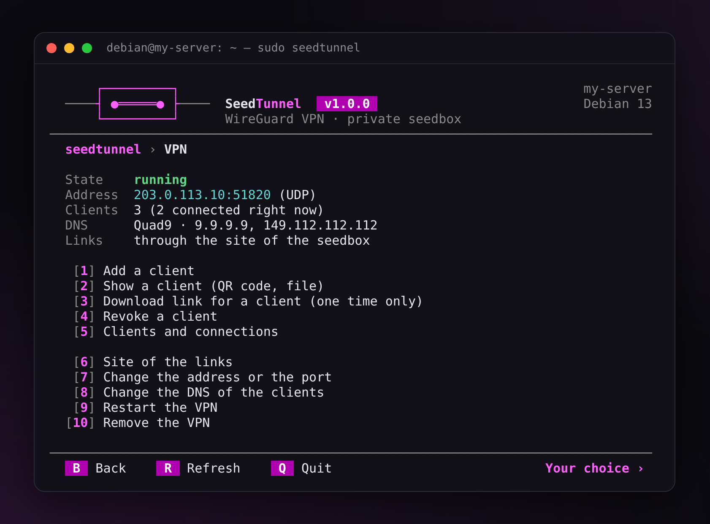
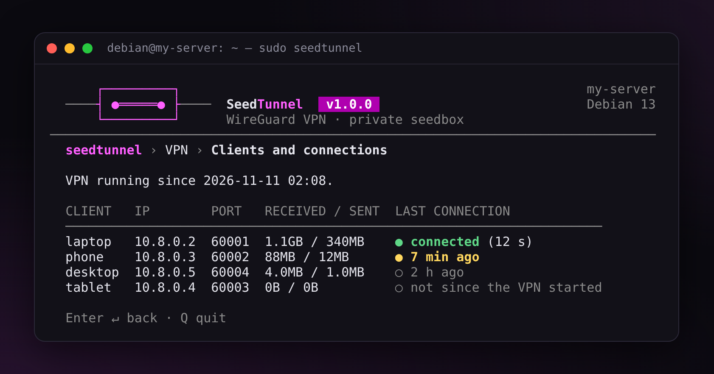
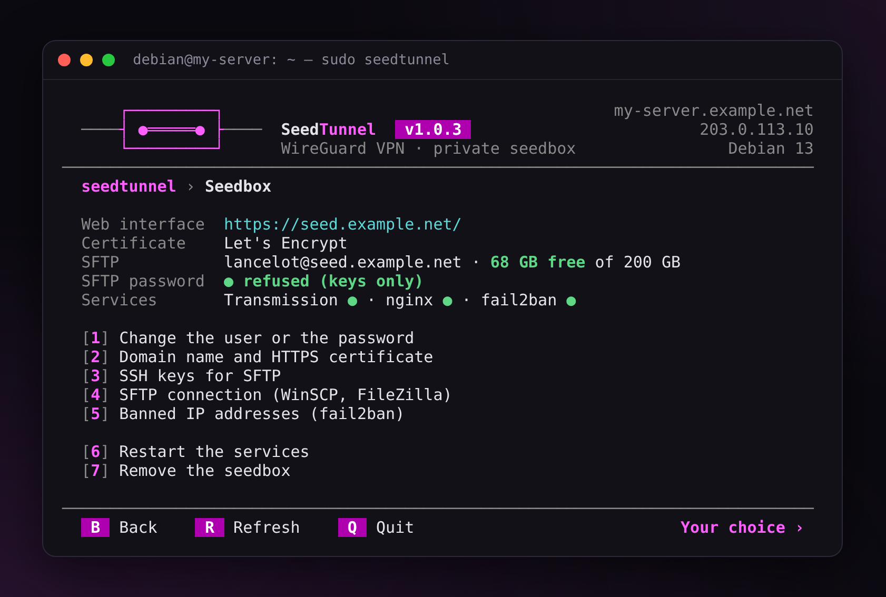
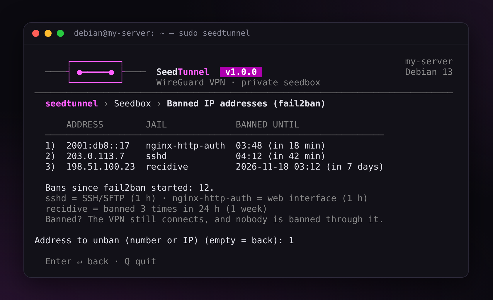

# SeedTunnel — Guide

*[Version française](guide.fr.md)* · [← Back to the README](../README.md)

## Requirements

- Debian **12 (bookworm)** or **13 (trixie)**, Ubuntu Server **24.04** or **26.04** (LTS): all four tested automatically at every change. Debian 11 is no longer supported (no security updates since 31 August 2026): upgrade to Debian 12, then 13;
- on Ubuntu, ufw (its firewall) turned off: `sudo ufw disable`. While it is on, seedtunnel installs nothing, since ufw would block the VPN and the seedbox; seedtunnel has its own firewall (`seedtunnel firewall enable`);
- a KVM virtual server or a dedicated server. Container-based servers (OpenVZ, LXC) often lack WireGuard: the script detects it and tells you.

## Installation

The recommended installation, from a published version, is in the [README](../README.md#installation). Below: how to check the archive, installing with git, updates and the way back.

### Checking the archive

Each archive also comes with an attestation signed by GitHub. With the [GitHub CLI](https://cli.github.com/), `gh attestation verify seedtunnel-$V.tar.gz --repo finalcutgit411/seedtunnel` proves that it was built by GitHub, from this repository, by its publication workflow.

### With git

To follow the development, or if you prefer git:

```bash
apt update && apt full-upgrade -y && apt install -y git
git clone https://github.com/finalcutgit411/seedtunnel.git /opt/seedtunnel
/opt/seedtunnel/seedtunnel.sh
```

In that case, `seedtunnel update` moves to the latest published version (tag `vX.Y.Z`).

The code is meant to be read: feel free to look through `seedtunnel.sh` and `lib/` before running it.

After that, the `seedtunnel` command opens the menu again. `seedtunnel update` moves to the next version after checking its checksum, then applies the configuration again so that its fixes take effect. If that fails, the previous version comes back.

The version replaced by an update is kept in `/opt/seedtunnel.old` (one only). `seedtunnel update back` puts it back, after a question answered « no » by default; it applies the settings again, and if that fails, the newer version comes back. `seedtunnel update` installs the newer version again later.

If the server lost power during an update, the `seedtunnel` command may no longer exist: the installed version is then in `/opt/seedtunnel.previous`. To put it back:

```bash
mv /opt/seedtunnel.previous /opt/seedtunnel
```

If `/opt/seedtunnel` exists too, `seedtunnel update` refuses to go on as long as `/opt/seedtunnel.previous` is there. If seedtunnel works, delete it: `rm -rf /opt/seedtunnel.previous`.

## Usage

### Menu

`seedtunnel` without arguments gives access to everything: VPN, seedbox, firewall, diagnostics, backups, update. The home screen shows the state of the server in five blocks — VPN (connected clients), seedbox, firewall, disk, backup — in green, yellow or red.

The keys are the same in every menu: `B` (or an empty answer) goes back, `R` refreshes, `Q` leaves seedtunnel. Every question can be left with an empty answer: you go back, nothing is changed. If an action fails, its message stays on the screen and Enter goes back to the menu.

The menus are pure bash: they work over SSH, in PuTTY as it is, with or without colors (`NO_COLOR` is honored), and fit the width of the window. To see them with example data, without installing anything: `bash tools/preview.sh` (`--fr` in French).

<p align="center"></p>

### Commands

```text
seedtunnel vpn install [--config FILE]      seedtunnel seedbox install [--config FILE] [--staging]
seedtunnel vpn add phone [--qr]             seedtunnel seedbox password [--user NAME]
seedtunnel vpn remove phone --yes           seedtunnel seedbox domain my.domain.com [--staging]
seedtunnel vpn list                         seedtunnel seedbox sftp-config [winscp|filezilla]
seedtunnel vpn show phone                   seedtunnel seedbox sftp-key add my-key.pub
seedtunnel vpn share laptop                 seedtunnel seedbox sftp-key new
seedtunnel vpn dns adguard                  seedtunnel seedbox sftp-password off
                                            seedtunnel seedbox bans | unban IP
seedtunnel firewall enable|disable|status   seedtunnel doctor [--link]
seedtunnel firewall rules
seedtunnel backup [--passphrase-file F]     seedtunnel backup list | share
seedtunnel backup auto on|off|status        seedtunnel restore [FILE] [--passphrase-file F]
seedtunnel update                           seedtunnel apply
seedtunnel language en|fr
```

`seedtunnel help` gives the details.

Without a terminal (in a script), destructive actions require `--yes`. The password is then given on the standard input:

```bash
printf '%s\n' "$NEW_PASSWORD" | seedtunnel seedbox password
```

### Configuration file

Everything the menu asks can be written in a file. The commented template is `examples/seedtunnel.conf`.

```bash
cp /opt/seedtunnel/examples/seedtunnel.conf /root/server.conf && chmod 600 /root/server.conf
nano /root/server.conf
seedtunnel vpn install --config /root/server.conf
seedtunnel seedbox install --config /root/server.conf
```

The installation is **idempotent**: run again with the same file, it changes nothing and restarts no service. If something was changed by hand, it puts everything back in order, keeps a copy of what was changed in `/etc/seedtunnel/changed-by-hand/`, and says it (`seedtunnel doctor` too).

The file is never executed: it is only read line by line, and unknown keys are refused.

### Language

The first time the menu opens, it asks for the language: English or French. To change it later: `seedtunnel language fr` (or `en`), or `L` in the menu. The `LANGUAGE` key of the configuration file does the same, and `SEEDTUNNEL_LANG=fr` in the environment changes it for one command only.

## What the script does

### VPN

| | |
|---|---|
| Network | 10.8.0.0/24, server at 10.8.0.1 |
| Port | 51820/UDP by default |
| Clients | up to 253, named, can be revoked, applied without restarting |
| Open port | client number N gets port 60000+N, TCP and UDP |
| Leaks | all the IPv4 and IPv6 traffic of the client goes through the tunnel, while the tunnel is up (see the kill switch below) |
| Getting the configuration | QR code for phones, or a one-time download link for computers |
| DNS of the clients | Quad9 by default; Cloudflare, DNS4EU (European Union), AdGuard (blocks ads too) or your own addresses. To change it: menu VPN → « Change the DNS of the clients », or `seedtunnel vpn dns adguard`. Each client keeps the previous one until it imports its configuration again |
| Connections | « Clients and connections »: connected (green), less than an hour ago (yellow), older, or not since the VPN started (WireGuard forgets them when it restarts) |

<p align="center"></p>

### Seedbox

| | |
|---|---|
| Web interface | `https://your-domain/` (user name + password), in the colors of seedtunnel (Transmission 3 and 4). After « Cancel » or a wrong password, a sober « Access denied » page: no name, nothing about what is behind |
| Files | SFTP (WinSCP, FileZilla, Cyberduck), password and/or SSH keys; settings ready to import with `seedtunnel seedbox sftp-config` |
| Certificate | Let's Encrypt, or self-signed if no domain name points to the server |
| Folders | `watch/` (drop a .torrent here), `incomplete/`, `complete/`, `documents/` |
| Protection | fail2ban on SSH/SFTP, the web password and repeat offenders. The addresses banned right now, with the end of their ban: menu Seedbox → « Banned IP addresses », or `seedtunnel seedbox bans` |
| Full disk | checked every 5 minutes: under 3 GB free, Transmission is stopped cleanly; it starts again by itself above 5 GB |

<p align="center"></p>

<p align="center"></p>

No domain name? Most providers give one (for example `vps-1234abcd.vps.ovh.net`). The script suggests it if it points to the server.

For your tests, `--staging` uses the test servers of Let's Encrypt. Their limits are much higher, but browsers do not trust their certificates.

### One-time download links

No need for `scp` to get a file onto your computer:

- `seedtunnel vpn share laptop` gives a link to the WireGuard configuration of the client;
- `seedtunnel backup share` gives a link to the latest backup;
- `seedtunnel seedbox sftp-config` gives an address to paste into WinSCP, with the fingerprint of the server inside: WinSCP checks by itself that it is the right server, without a question at the first connection. With `winscp` or `filezilla`, it also gives a link to a profile to import into that program (the site, without the password);
- `seedtunnel seedbox sftp-key new` creates an SSH key and gives a link to it as a .ppk file, ready for WinSCP and FileZilla: SFTP without a password. No copy of the private key stays on the server.

The link goes through the HTTPS site of the seedbox. It holds a random token that cannot be guessed, works **only once** and expires after **10 minutes**. nginx serves the file once: any other request on it is refused, even right after on the same connection or with another form of the address, never a partial download, and the file is deleted right away. A HEAD request is refused without using the link up. Opening the page does not count, only downloading the file does, so an automatic link preview in a messaging app does not waste it. A link already used or expired shows a page that says so.

The token is hidden in the log of nginx (`/share/<token>/…`): the log still says who downloaded, when, and whether it worked.

### Firewall

`seedtunnel firewall enable` refuses everything that reaches the server, except:
- SSH, on the port actually used;
- the VPN and the seedbox, if installed;
- the ICMP that IPv6 needs.

This concerns what reaches the server itself. The VPN clients are trusted: what comes from them through the tunnel is accepted.

In a terminal, every change is **tried first**: without a confirmation from a new SSH connection within 2 minutes, the previous rules come back (or no rules, the first time). « yes » only counts once sshd has accepted a new login since the rules were applied: from the Internet, it always counts; through the VPN, only if your session comes through the VPN too; from the server itself, never. A confirmation from the Internet proves nothing for the VPN: its port is checked by the automatic tests, with a new tunnel through the firewall. The rules loaded at boot only change once confirmed.

`seedtunnel firewall rules` (or « Show the rules » in the menu) lists, in words, the rules nftables really has loaded right now, and the ports forwarded to each VPN client (they can be reached from the Internet). What differs from the settings is pointed out. The raw rules can be shown too.

### Banned from SSH? Come back through the VPN

With the seedbox, fail2ban bans an address after 5 failed logins in 10 minutes: for 1 hour, and for 1 week after 3 bans in 24 hours. Your own address too, when you make a mistake or test. The ban closes every TCP port (SSH, SFTP, the web interface), but not the VPN, which works over UDP; and the addresses of the VPN (10.8.0.x) are never banned. So, from the banned computer:

1. turn the VPN on;
2. `ssh your-user@10.8.0.1`: the server, through the tunnel;
3. `sudo seedtunnel`, then Seedbox → « Banned IP addresses »: your address and the end of its ban; type its number to unban it (or `sudo seedtunnel seedbox unban IP`).

Your address is not in the list? Look for an IPv6 address: many home connections reach the server in IPv6.

<p align="center"></p>

### Diagnostics

`seedtunnel doctor` checks, giving for every problem the command that fixes it:
- the services, and that they will start again with the server;
- the DNS;
- the expiry of the certificate and its renewal;
- the ports and the firewall, including the SSH port: a port changed without updating the firewall would lock you out; that the firewall really refuses what is not allowed;
- the NAT of the VPN, made for the network interface the server uses now;
- that the traffic of the VPN clients can cross the server: a firewall of another program (Docker most of all) that refuses it by default lets the clients connect without Internet (see « Known limits »);
- the kernel network settings (IPv4, and IPv6 if the server has it);
- the disk space, the full disk protection (including a Transmission that does not start again although there is room) and the clock;
- an update or a restore that did not finish, and the settings a finished restore replaced, still kept;
- a restart advised: a kernel installed since the server started and not used yet;
- the backups (see below), including the timer and the passphrase of the weekly backup;
- the BitTorrent port seen from the Internet, by the test service of Transmission (closed: check the firewall of your hosting provider, such as the « Edge Network Firewall » at OVH);
- the SFTP password: a warning when it is still allowed although you have an SSH key.

It exits with status 1 when it finds a problem, so it can run in a scheduled task.

<p align="center"></p>

Everything seedtunnel runs is written to `/var/log/seedtunnel.log` (readable by root only, never a password). It is cut every month by logrotate; the last 6 months are kept, compressed. With less than 100 MB free on the system disk, seedtunnel changes nothing and says so first.

To ask for help, `seedtunnel doctor --link` (or the question at the end of the diagnostics, in the menu) makes a **report** — the diagnostics and the end of the log — and a one-time link to send it. What is private is replaced by a generic word: domain, name of the server, public IP addresses, SFTP account, SSH keys, names of the VPN clients (`<client-1>`…). The ports and the addresses inside the VPN (10.8.0.x, the same on every server) stay. It never holds a password, a passphrase or a key. Without a seedbox, the report is saved in your home folder.

### Backups

`seedtunnel backup` creates an encrypted archive (AES-256) in `/var/backups/seedtunnel`, with:
- the keys and clients of the VPN;
- the settings and password hashes of the seedbox;
- the certificates and the SSH keys of SFTP;
- the firewall;
- the list of torrents and the settings of Transmission.

If a setting changes while the archive is written (renewal of a certificate, for example), the archive is made again, up to 3 times: a backup never mixes old and new settings. An existing file is never replaced: `--output` refuses a name already taken.

`seedtunnel backup auto on` makes an encrypted backup **every week** and keeps the last 4. Its passphrase is saved on the server (readable by root only) so that it can run alone: write it down somewhere else too. Turning it off (`seedtunnel backup auto off`, or the menu) asks first: the saved passphrase is deleted.

A backup that stays on the server disappears with it: `seedtunnel backup share` gives a one-time link to download the latest one onto your computer. `seedtunnel doctor` reminds you when the weekly backup is off or fails, and when no backup was downloaded for a month.

In the menu (Backup / restore → « Restore a backup »), the backups of the server and those copied into `/root` or a home folder (WinSCP, scp) are listed, the newest first: type a number, or the path of another file. `seedtunnel restore` without a file shows the same list.

On a new server, `seedtunnel restore FILE` puts everything back, Debian or Ubuntu: a backup made on another system (or another version) is said, and restored the same way: each of the four systems was restored onto the others on real servers. The archive is checked first, so that a backup made by someone else cannot run anything: only files and folders (and the links of Let's Encrypt), none that could be run, settings files that cannot run any command and hold only the settings seedtunnel writes, with values it would accept at an installation. Of Let's Encrypt, only the certificate of seedtunnel and its account go back, and its renewal file may run nothing but the reload of nginx: the other certificates of the server are left alone. The VPN clients connect again without any change if `VPN_PUBLIC_ADDRESS` is a domain name pointing to the new server.

On a server that already has seedtunnel, the backup must fit it, checked before anything is replaced: a VPN or a seedbox of the server missing from the backup, another SFTP account than the one of the seedbox, or an account of the backup that already exists on the server, and the restore stops, saying what to do. The firewall and the weekly backup of the server stay on when the backup has none. A restore cut short (power cut) is pointed out by `seedtunnel doctor` and the menu, with the way back: one command puts back the settings, the SSH keys of SFTP, the certificate and the list of torrents from before. Once a restore is finished, the settings it replaced stay in `/etc/seedtunnel.before-restore-…` (old keys, passwords, passphrase): the end of the restore and `seedtunnel doctor` give the command to delete them once everything works. A new server has nothing to keep aside.

Downloaded files are not in the backup. At the restore, the torrents come back through `watch/`, as new ones: Transmission checks each one against the files already in the data folder before starting it, and goes on from there (from zero without them). Moving to a new server: copy the downloads first, then restore:

```bash
rsync -a --info=progress2 old-server:/srv/seedbox/complete/ /srv/seedbox/complete/
```

Copied after the restore, verify the torrents in the web interface (select them, right-click → « Verify Local Data »). Not kept: the pauses, the files left out of a torrent, the statistics (sent, ratio). This works between every version of Transmission, a backup of Ubuntu 26.04 (Transmission 4.1) restored on Debian 12 (Transmission 3) included. The torrents added by a magnet link and still without their metadata come back too, through `watch/` with Transmission 4; Transmission 3 (Debian 12) cannot read them there: their links are saved in `/root/seedtunnel-magnets.txt`, to add again in the web interface.

## Known limits

- **WireGuard only works over UDP.** On a network that blocks UDP, try UDP port 443: it is often open, since HTTP/3 uses it.
- **The VPN is IPv4 only.** The IPv6 of the clients is blocked in the tunnel rather than leaking.
- **If the tunnel drops, the client goes out without it**, with its real address: the server cannot prevent that, the client must. To block everything outside the tunnel (kill switch):
  - Windows: WireGuard app → Edit the tunnel → tick « Block untunneled traffic (kill-switch) »;
  - Android: Settings → VPN → WireGuard (gear) → « Always-on VPN » and « Block connections without VPN »;
  - qBittorrent (any system): Options → Advanced → Network interface → the WireGuard tunnel: no tunnel, no download.
- **The seedbox has a single user.**
- **Docker on the same server can cut the VPN off from the Internet.** When it starts, Docker may refuse by default the traffic that crosses the server: the clients connect, but nothing comes back. `seedtunnel doctor` sees it. For good, add `"ip-forward-no-drop": true` to `/etc/docker/daemon.json` (if the file does not exist: `{ "ip-forward-no-drop": true }`) and check it with `sudo dockerd --validate --config-file /etc/docker/daemon.json`; it counts from the next restart of the server. Until then (`ens3`: the network interface of your server, given by `ip route show default`):
  ```
  sudo iptables -I DOCKER-USER -i wg0 -o ens3 -j ACCEPT
  sudo iptables -I DOCKER-USER -i ens3 -o wg0 -m conntrack --ctstate RELATED,ESTABLISHED,DNAT -j ACCEPT
  ```

## Uninstalling

`seedtunnel seedbox uninstall`, `seedtunnel vpn uninstall`, `seedtunnel firewall disable`, or the options of the menu.

The downloaded data is kept, unless `--purge-data` is given. The backups stay in `/var/backups/seedtunnel`. Only the packages installed by seedtunnel are removed (listed in `/etc/seedtunnel/packages`): an nginx that was there before, for example, stays. The removal is tried first (`apt-get -s`): if it would also take a package that seedtunnel did not install, nothing is removed and the packages concerned are named.
