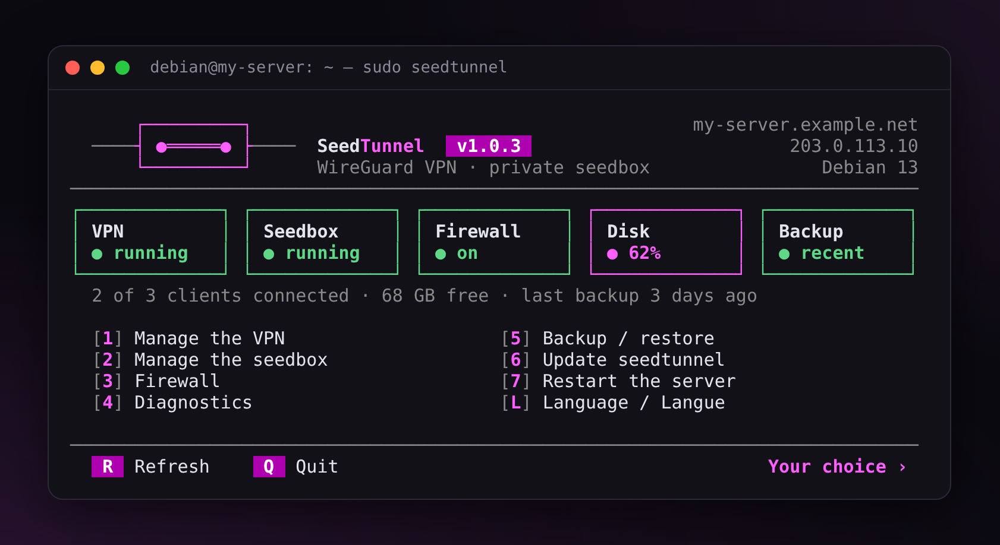
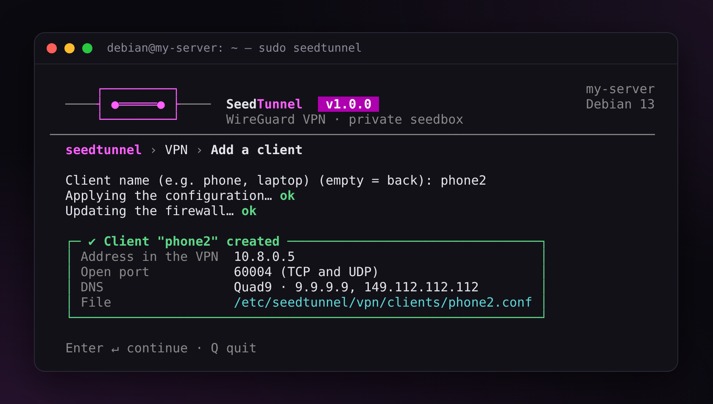
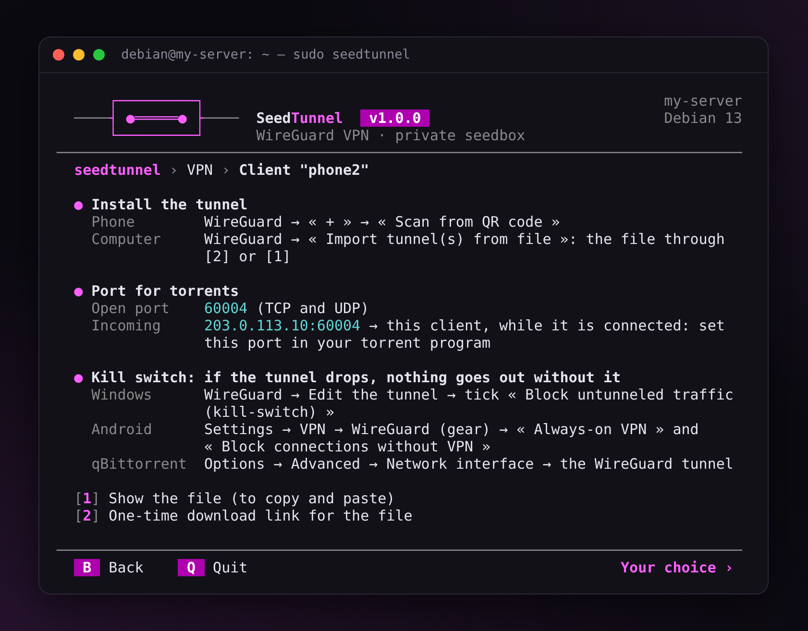
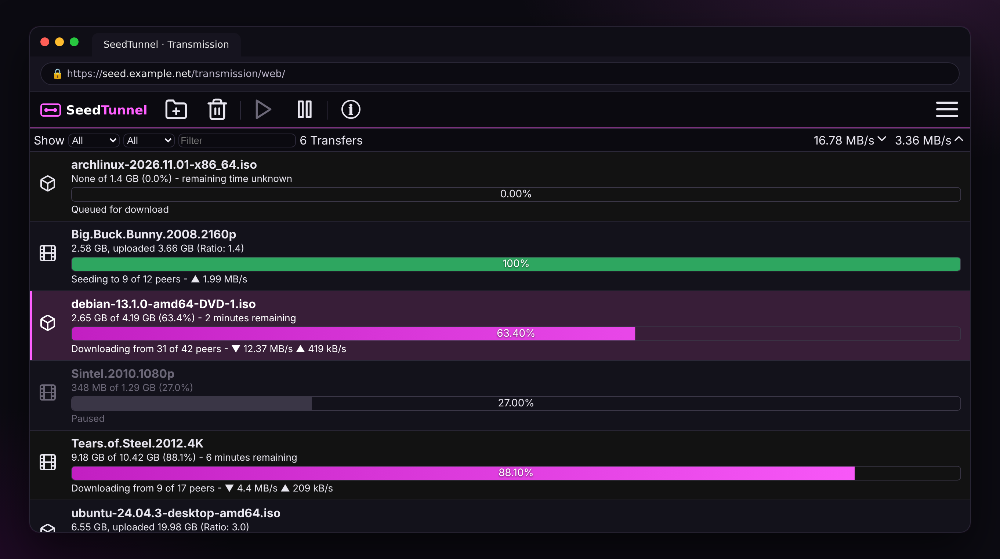
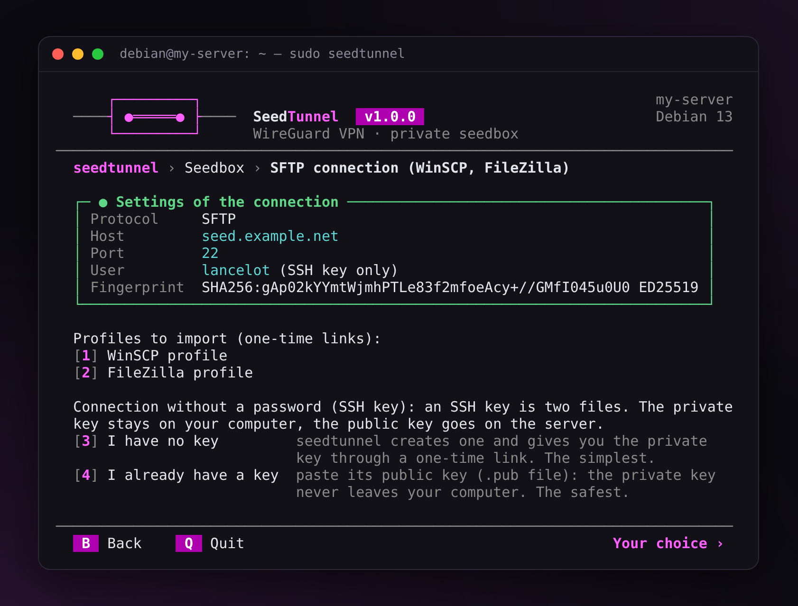
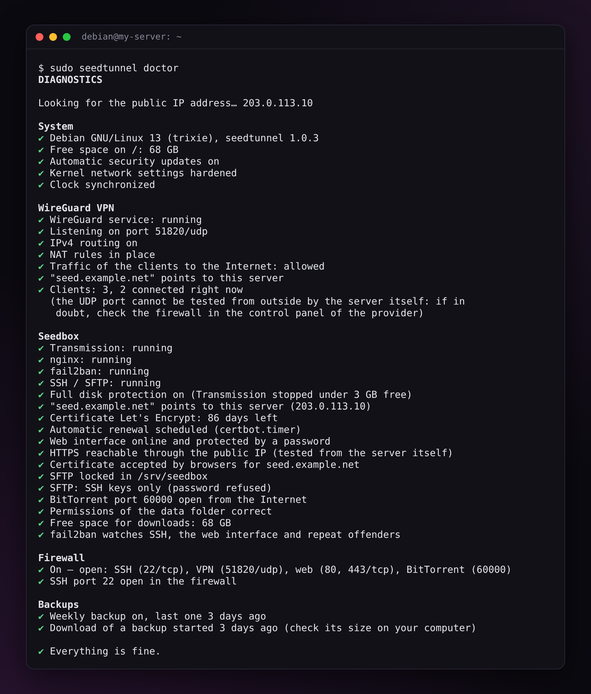
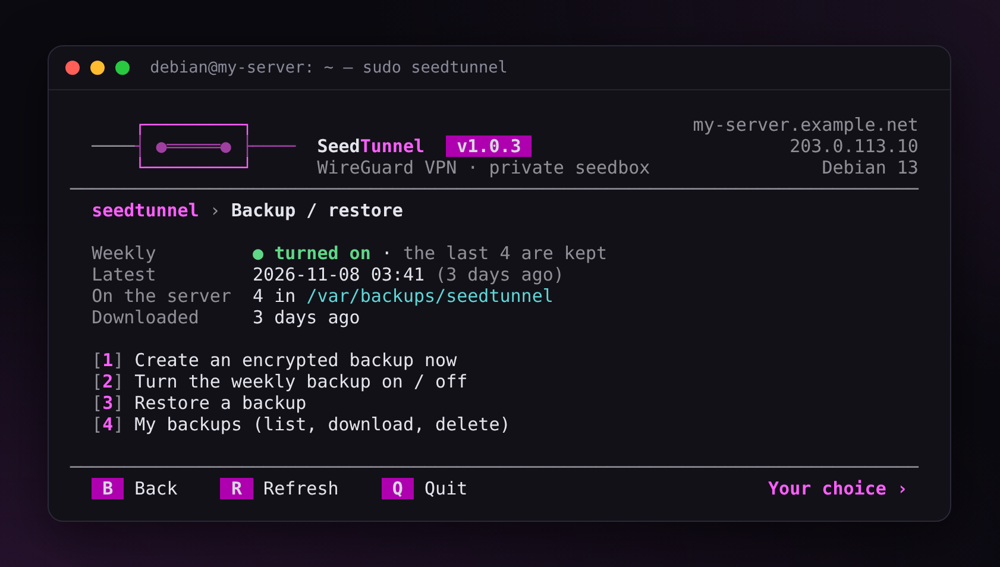
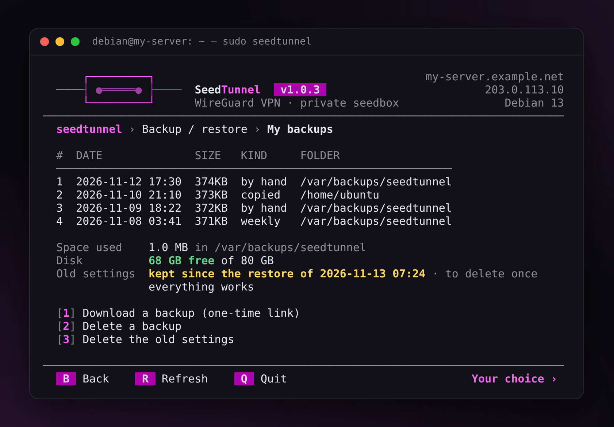
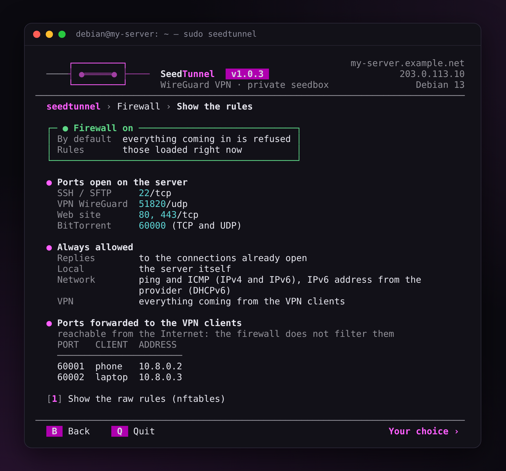

# SeedTunnel — Guide

*[Version française](guide.fr.md)* · [← Back to the README](../README.md)

This guide goes straight to the point: each part says what to do, in the menu. The matching commands are at the end, in the [reference](#8-reference).

1. [Before you start](#1-before-you-start)
2. [Install](#2-install)
3. [The VPN](#3-the-vpn)
4. [The seedbox](#4-the-seedbox)
5. [Get your files (SFTP)](#5-get-your-files-sftp)
6. [Upkeep: diagnostics, backups, updates, firewall](#6-upkeep-diagnostics-backups-updates-firewall)
7. [When something goes wrong](#7-when-something-goes-wrong)
8. [Reference](#8-reference)

## 1. Before you start

- **A server**: a KVM VPS or a dedicated server, running Debian 12 or 13, or Ubuntu Server 24.04 or 26.04. 1 GB of RAM is enough; for a seedbox, plan above all for disk space. Container VPS (OpenVZ, LXC) often lack WireGuard: SeedTunnel finds out and says so.
- **SSH access**: the address of the server, an account and its password (or its key), given by the provider. On Windows, PuTTY or the Terminal will do: `ssh debian@SERVER-ADDRESS`.
- **A domain name**, if you can. It gives a real HTTPS certificate and a VPN that follows the server if its address changes. No domain? Most providers give one (for example `vps-1234abcd.vps.ovh.net`): SeedTunnel offers it if it points to the server.
- **ufw** (the firewall of Ubuntu) must be off. While it is on, SeedTunnel installs nothing and tells you so: type `ufw disable`, then turn on the firewall of SeedTunnel (see [Firewall](#firewall)).

## 2. Install

Log in with SSH, then:

```bash
sudo -i
apt update && apt full-upgrade -y
V=1.0.3
cd "$(mktemp -d)"
curl -fLO https://github.com/finalcutgit411/seedtunnel/releases/download/v$V/seedtunnel-$V.tar.gz \
  && curl -fLO https://github.com/finalcutgit411/seedtunnel/releases/download/v$V/SHA256SUMS \
  && sha256sum -c SHA256SUMS \
  && tar -xzf seedtunnel-$V.tar.gz \
  && mv seedtunnel-$V /opt/seedtunnel \
  && /opt/seedtunnel/seedtunnel.sh
```

`sha256sum -c` must answer `OK`: otherwise the archive is not started.

The menu opens and first asks for the language. Later, `sudo seedtunnel` opens it again.

<p align="center"></p>

The home screen shows the state of the server in five blocks: green, fine; yellow, keep an eye on it; red, a problem. In every menu, type the number of a choice, `B` to go back, `Q` to quit. An empty answer to a question goes back without changing anything.

## 3. The VPN

### Install the VPN

Home → `[1] Install the VPN`. It asks for:

1. **the address of the server**: the one offered (its IP) is fine; a domain name is even better;
2. **the port**: keep `51820`;
3. **the name of the first device**, for example `phone`.

### Connect a phone

Install the **WireGuard** app (Play Store, App Store). The QR code of the phone shows alone on the screen: in the app, `+` → « Scan from QR code ». Window too small for the QR code? Make it bigger, then `R`.

<p align="center"></p>

### Connect a computer

1. VPN menu → `[1] Add a client`, for example `laptop`.
2. On the screen of the device, `[2] One-time download link for the file`.
3. Open the link on the computer, download the `.conf` file.
4. WireGuard app → « Import tunnel(s) from file » → that file.

The link works **only once** and lasts **10 minutes**.

Without a seedbox, the first link offers to install a small HTTPS site that only serves the links (ports 80 and 443): answer Enter. Without a domain name, its certificate is « self-signed »: the browser shows a warning. Check that the SHA-256 fingerprint given by SeedTunnel is the same as the one of the browser, then accept.

<p align="center"></p>

### Check

With the VPN on, open a site that shows your IP address: you must see the one of the server.

### Good to know

- **One device = one client.** Lost or stolen: VPN menu → `[4] Revoke a client`.
- **`[5] Clients and connections`**: who is connected right now.
- **A port for your torrents**: each device gets an open port (60001, 60002…), shown on its screen. Put it in your torrent program.
- **Kill switch**: if the tunnel drops, the device goes out with its real address. To prevent it: Windows, WireGuard → Edit the tunnel → tick « Block untunneled traffic (kill-switch) »; Android, Settings → VPN → WireGuard → « Always-on VPN » and « Block connections without VPN »; qBittorrent, Options → Advanced → Network interface → the tunnel.
- **DNS**: Quad9 by default. `[8] Change the DNS of the clients` also offers Cloudflare, DNS4EU and AdGuard (which blocks ads). Each device must then import its file again.

<p align="center"></p>

## 4. The seedbox

### Install the seedbox

Home → `[2] Install the seedbox`. It asks for:

1. **a user name and a password**: for the web interface and for SFTP;
2. **the domain name** (or the IP): with a domain that points to the server, the certificate comes from Let's Encrypt and renews by itself; with the IP, it is self-signed;
3. **the data folder**: keep `/srv/seedbox`.

Let's Encrypt gives at most 5 certificates a week for the same name. If it refuses, SeedTunnel keeps a self-signed certificate and says so.

### The web interface

Open `https://your-domain/`, type the name and the password: this is Transmission, in the colors of SeedTunnel. To add a torrent: the open button of Transmission (a `.torrent` file or a magnet link), or drop a `.torrent` in the `watch/` folder over SFTP.

<p align="center"></p>

### Your files

Everything is in `/srv/seedbox`: `incomplete/` while downloading, `complete/` once done, `watch/` to drop `.torrent` files, `documents/` for the rest.

Under 3 GB free, Transmission stops cleanly: the disk never fills up. It starts again by itself above 5 GB.

<p align="center"></p>

## 5. Get your files (SFTP)

Seedbox menu → `[4] SFTP connection (WinSCP, FileZilla)`. The settings show (host, port, user), then:

- **`[1] WinSCP profile`**: a link to a profile ready to import. In WinSCP: « Tools » → « Import Sites… » → « INI file » → choose the file → tick the site → OK.
- **`[2] FileZilla profile`**: in FileZilla, « File » → « Import… » → the file.

The profile holds the fingerprint of the server: no question at the first connection.

<p align="center"></p>

### Without a password: an SSH key

- **`[3] I have no key`**: SeedTunnel creates one and gives a link to the `.ppk` file. Keep it, without renaming it, in `C:\Users\YOUR-NAME\.ssh` (create the folder if needed): the WinSCP profile finds it by itself. No copy stays on the server.
- **`[4] I already have a key`**: paste your **public** key (the `.pub` file), never the private one.

Once the connection with the key works, refuse the password: Seedbox menu → `[3] SSH keys for SFTP`, or `seedtunnel seedbox sftp-password off`.

The SFTP account only sees `/srv/seedbox`. To send a file elsewhere on the server (a backup, for example), log in with your usual account, not with the « Seedbox » profile.

## 6. Upkeep: diagnostics, backups, updates, firewall

### Diagnostics

Home → `[4] Diagnostics`, or `sudo seedtunnel doctor`. It checks the whole server: ✔ in order, ! keep an eye on it, ✘ a problem, each time with the command that fixes it.

<p align="center"></p>

### Backups

Home → `[5] Backup / restore`.

<p align="center"></p>

- **`[1] Create an encrypted backup now`**: choose a passphrase, then answer Enter to « Download it now? » and open the link on your computer. **Keep the file and the passphrase off the server**: without the passphrase, the backup does not open.
- **`[2] Turn the weekly backup on / off`**: a backup every week, the last 4 kept. Its passphrase is saved on the server (readable by root only): write it down elsewhere too.
- **`[4] My backups`**: every backup, to download or to delete.

A backup holds the settings: keys of the VPN, seedbox, certificate, SSH keys, firewall, list of torrents. Not the downloaded files.

<p align="center"></p>

### Restore, or move to another server

1. On the new server, install SeedTunnel ([part 2](#2-install)), then quit the menu.
2. With WinSCP and your usual account, send the backup to your home folder.
3. If you move to another server, first copy your downloads, from the new server:
   ```bash
   rsync -a --info=progress2 old-server:/srv/seedbox/complete/ /srv/seedbox/complete/
   ```
4. `sudo seedtunnel restore`: choose the backup in the list, type the passphrase.

Everything comes back: the VPN (the devices reconnect without any change if the address of the VPN is a domain name, pointed to the new server), the seedbox, the certificate (no new request), the SSH keys, the firewall. The torrents start again and find the files already copied.

The restore keeps aside the settings it replaces, in `/etc/seedtunnel.before-restore-…`. Once everything works, delete them: `[4] My backups` → `[3] Delete the old settings`.

### Update

Home → `[6] Update seedtunnel`, or `sudo seedtunnel update`. The new version is checked before it is installed; if something goes wrong, the old one comes back by itself. To go back to the previous version anyway: `sudo seedtunnel update back`.

### Firewall

Home → `[3] Firewall` → `[1] Enable / update the firewall`. Everything that comes to the server is refused, except SSH, the VPN, the seedbox and the BitTorrent port.

The firewall is turned on **as a trial**: open a **new** SSH connection (a second PuTTY window), without closing the first one, then answer `yes` in the first one. Otherwise it removes itself after 2 minutes: you cannot lock yourself out.

`[3] Show the rules` shows in plain words what is open.

<p align="center"></p>

Your provider may have its own firewall (at OVH: « Edge Network Firewall »): it must let the same ports through.

## 7. When something goes wrong

Always start with the diagnostic: `sudo seedtunnel doctor`.

| What happens | What to do |
|---|---|
| SSH refuses you after wrong passwords | You are banned for 1 hour (see below). |
| The VPN connects, but no Internet | The diagnostic sees it. Most of the time, Docker on the same server (see the [reference](#known-limits)). |
| The BitTorrent port is closed | Open it in the firewall of the provider. |
| The browser warns about HTTPS | Self-signed certificate: compare the SHA-256 fingerprint, or use a domain name. |
| Downloads stop | The disk is almost full: free some space. |
| The restore refuses the backup | Read the message: it says what to do. A wrong passphrase 3 times stops everything, with nothing changed. |

### Banned from SSH? Come back through the VPN

After 5 failed logins in 10 minutes, fail2ban bans your address for 1 hour (1 week after 3 bans in 24 hours). The VPN stays open, and its addresses are never banned:

1. turn on the VPN on the banned computer;
2. `ssh your-account@10.8.0.1`;
3. `sudo seedtunnel` → Seedbox → `[5] Banned IP addresses`: type the number of your address to unban it.

Your address is not there? Look for an IPv6 address: many home connections go through IPv6.

<p align="center"></p>

### Ask for help

`sudo seedtunnel doctor --link` makes a report (the diagnostic and the end of the log) and a link to download it. Your domain, your IP addresses, your accounts and the names of your devices are replaced in it; it never holds a password, a passphrase or a key. Attach it to your post on the forum or to an [issue on GitHub](https://github.com/finalcutgit411/seedtunnel/issues). Never post a `.conf` file of the VPN nor a key.

## 8. Reference

### Commands

As root, or with `sudo` in front. `seedtunnel help` gives the details.

```text
seedtunnel vpn install [--config FILE]      seedtunnel seedbox install [--config FILE] [--staging]
seedtunnel vpn add phone [--qr]             seedtunnel seedbox password [--user NAME]
seedtunnel vpn remove phone --yes           seedtunnel seedbox domain my.domain.net [--staging]
seedtunnel vpn list                         seedtunnel seedbox sftp-config [winscp|filezilla]
seedtunnel vpn show phone                   seedtunnel seedbox sftp-key add my-key.pub
seedtunnel vpn share laptop                 seedtunnel seedbox sftp-key new
seedtunnel vpn dns adguard                  seedtunnel seedbox sftp-password on|off
seedtunnel vpn links on|off                 seedtunnel seedbox bans | unban IP
seedtunnel firewall enable|disable|status   seedtunnel doctor [--link]
seedtunnel firewall rules                   seedtunnel backup auto on|off|status
seedtunnel backup [--passphrase-file F]     seedtunnel backup list | share [N] | delete N
seedtunnel restore [FILE]                   seedtunnel restore clean
seedtunnel update | update back             seedtunnel apply
seedtunnel language en|fr                   seedtunnel version
```

Without a terminal (in a script), the actions that delete something ask for `--yes`.

### Configuration file

Everything the menu asks can be written in a file, to set up a server again the same way:

```bash
cp /opt/seedtunnel/examples/seedtunnel.conf /root/server.conf && chmod 600 /root/server.conf
nano /root/server.conf
seedtunnel vpn install --config /root/server.conf
seedtunnel seedbox install --config /root/server.conf
```

Run again, the installation only changes what needs to change. A file changed by hand is put back in order, and a copy is kept in `/etc/seedtunnel/changed-by-hand/`. The file is never run, only read.

### What SeedTunnel installs

| | |
|---|---|
| Code | `/opt/seedtunnel`, the `seedtunnel` command in `/usr/local/bin` |
| Settings | `/etc/seedtunnel` (root only) |
| Log | `/var/log/seedtunnel.log` (root only, never a password, 6 months kept) |
| Downloads | `/srv/seedbox` |
| Backups | `/var/backups/seedtunnel` |
| VPN | network 10.8.0.0/24 (server 10.8.0.1), port 51820/UDP, up to 253 devices, port 60000+N per device |
| Packages | those of your distribution: WireGuard, Transmission, nginx, certbot, fail2ban, nftables… noted to be removed at uninstall |

### Known limits

- **WireGuard only goes over UDP.** On a network that blocks UDP, try port 443 (VPN menu → `[7] Change the address or the port`).
- **The VPN is IPv4.** The IPv6 of the devices is blocked in the tunnel rather than leaking.
- **One person per seedbox.**
- **Docker on the same server** can cut the VPN off the Internet: the devices connect, but nothing comes back. The diagnostic sees it. The fix: add `"ip-forward-no-drop": true` to `/etc/docker/daemon.json` (the whole file, if it does not exist: `{ "ip-forward-no-drop": true }`), then restart the server. SeedTunnel never touches the rules of Docker.

### Other ways to install

- **Check where the archive comes from**: with the [GitHub tool](https://cli.github.com/), `gh attestation verify seedtunnel-$V.tar.gz --repo finalcutgit411/seedtunnel` proves it was built by GitHub from this repository.
- **With git**: `git clone https://github.com/finalcutgit411/seedtunnel.git /opt/seedtunnel`, then `/opt/seedtunnel/seedtunnel.sh`. `seedtunnel update` then goes to the latest published version.
- **An update cut short** (power cut): if the `seedtunnel` command no longer exists, `mv /opt/seedtunnel.previous /opt/seedtunnel` puts the installed version back.

### Uninstall

VPN menu → `[10] Remove the VPN`, Seedbox menu → `[7] Remove the seedbox`, or `seedtunnel vpn uninstall`, `seedtunnel seedbox uninstall`, `seedtunnel firewall disable`. Only the packages SeedTunnel installed are removed. Your downloads stay (unless `--purge-data`), and so do your backups.
